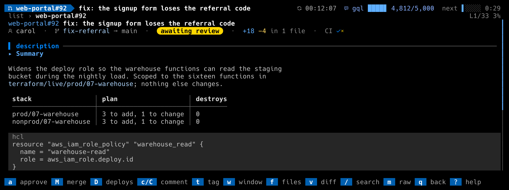
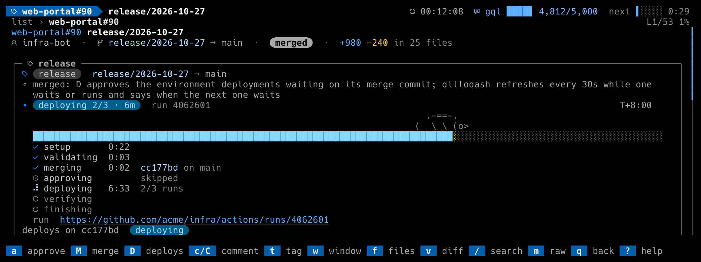
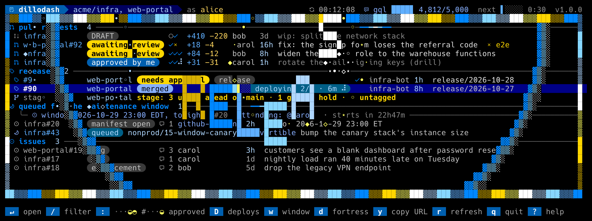
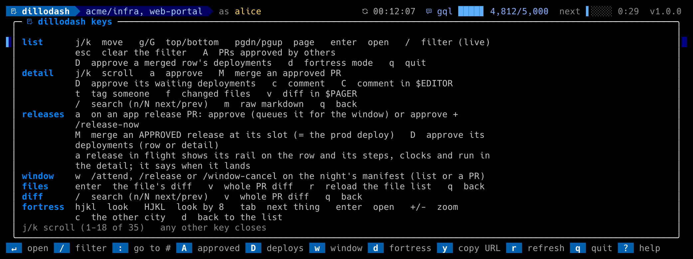
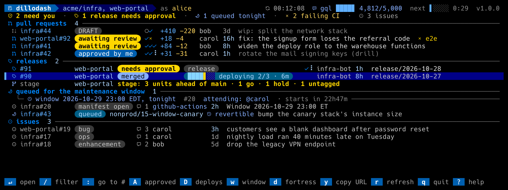

# dillodash

A terminal dashboard for the pull requests that are waiting on you. Open one,
read it, approve it, comment, merge it, approve its deployments, and watch CI
without leaving the terminal. Runs as a GitHub CLI extension, so it signs in
the way `gh` does, and it works against any GitHub organization, including
GitHub Enterprise Server.


Amos the armadillo lives in the splash screen and keeps you company when the
list is empty.

## Install

Needs the GitHub CLI (`gh` 2.x) and a terminal with 256 colors or
truecolor; the release binaries cover macOS, Linux, FreeBSD and Windows,
and building from source needs Go 1.27 or newer.

```sh
gh extension install solcyber/gh-dillodash
gh dillodash --demo            # try it on an offline fixture first, no GitHub needed
gh dillodash font install      # optional: the bundled Nerd Font for the icons
```

Sign in first with `gh auth login` if you have not. Then:

```sh
gh dillodash config init       # writes ~/.config/dillodash/config.toml
$EDITOR ~/.config/dillodash/config.toml
gh dillodash config check      # validates it and probes what your token can read
gh dillodash
```

The smallest working config is two lines:

```toml
[reviews]
repos = ["acme/infra", "acme/web-portal"]
```

Everything else is optional and documented in [`config.example.toml`](config.example.toml).
An organization can keep its config in a repo and install it with
`gh dillodash config pull owner/repo` (see [docs/configuration.md](docs/configuration.md)).

Upgrade with `gh extension upgrade dillodash`; remove it with
`gh extension remove dillodash` (the config in `~/.config/dillodash` and
any installed font stay until you delete them). When something looks
wrong, [docs/troubleshooting.md](docs/troubleshooting.md) lists the
symptoms.

## A tour









More in [docs/keys.md](docs/keys.md) and each workflow's page.

## What you see

- **The list.** Open pull requests across your repos, with a status chip
  (`awaiting review`, `approved by me`, `changes requested`, `DRAFT`), one
  glyph per CI check, the diffstat, the author and the age. Open issues sit
  below in their own section. `/` filters live as you type, `A` shows PRs
  approved by others, `:` opens any `#N` or `repo#N`.
- **A pull request.** The description and the comment thread rendered as
  markdown (tables, code, terraform plans colored), the review timeline, the
  changed files (`f`) and each file's diff, or the whole diff in `$PAGER`
  (`v`). `a` approves, `c`/`C` comment, `t` tags someone, `M` merges an
  approved PR, `D` approves the deployments waiting on a merged one.
- **The summary row** counts what needs you and what is failing; the status
  line explains every refusal in words; the header shows the GraphQL budget
  and when the next refresh lands.
- **Fortress mode** (`d`): everything open as a Dwarf Fortress map over
  Manhattan or Chicago. Row is age, lane is repo, shape is what it is.

It refreshes in the background every five minutes by default (`r` refreshes
now) and backs off by itself when GitHub rate-limits the token.

## Workflows



If your repositories run a bot that speaks one of these protocols, turn the
matching workflow on in the config and dillodash drives it:

| Workflow | What it adds | Doc |
|---|---|---|
| `terraform_approve` | `a` posts `/approve <plan-id>` from the plan digests on the PR, with the destroy count and the maintenance-window choice; plan cards in the detail view; apply outcomes read back | [docs/workflows/terraform-approve.md](docs/workflows/terraform-approve.md) |
| `maintenance_window` | a section of PRs queued for a nightly window, grouped by night with the countdown; `w` posts `/attend`, `/release` and `/window-cancel` on the night's manifest issue | [docs/workflows/maintenance-window.md](docs/workflows/maintenance-window.md) |
| `release_pr` | application releases as PRs into production across many repos, with the staging branch's units by tag, approve-to-queue or `/release-now`, `M` at the slot and `D` for the environment approvals | [docs/workflows/release-pr.md](docs/workflows/release-pr.md) |

Each doc specifies the comment formats the bot must emit, so any CI can be
taught to speak them. With no workflow configured dillodash is a plain,
fast reviewer.

## Keys

The essentials: `enter` opens, `a` approves, `c` comments, `M` merges,
`D` approves deployments, `/` filters or searches, `d` is fortress mode,
`?` is the help with every key and the glyph legend, `q` quits (`Esc`
clears the filter instead). Every key, per view, is in
[docs/keys.md](docs/keys.md), which is generated from the key table the
dashboard itself runs on.

## More

- [Configuration](docs/configuration.md): every key, with defaults.
- [Authentication and token permissions](docs/auth.md): what the `gh`
  token needs on each repo, and GitHub Enterprise.
- [Display](docs/display.md): the list columns, the chips, the colorblind
  palette, motion, and `--icons`/`--mono`/`--motion`.
- [Fonts](docs/fonts.md): the bundled Nerd Font and `gh dillodash font`.
- [Fortress mode](docs/fortress.md).
- [Troubleshooting](docs/troubleshooting.md).
- [Contributing](CONTRIBUTING.md), [Changelog](CHANGELOG.md), [Security](SECURITY.md).

dillodash is [MIT licensed](LICENSE). The bundled Hack Nerd Font Mono is
redistributed under Hack's MIT license and the Bitstream Vera license
([internal/fonts/LICENSE.md](internal/fonts/LICENSE.md)) and the Nerd
Fonts SIL Open Font License 1.1
([internal/fonts/NERD-FONTS-LICENSE.md](internal/fonts/NERD-FONTS-LICENSE.md));
`gh dillodash font license` prints them, and `font install` writes them
beside the font files.
