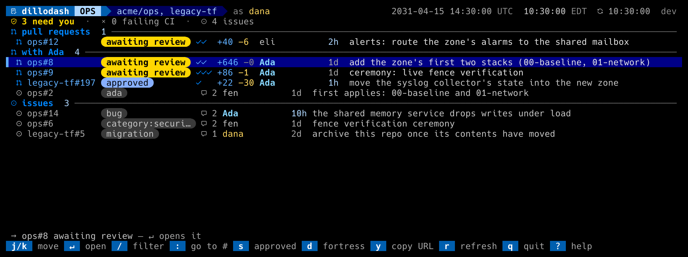
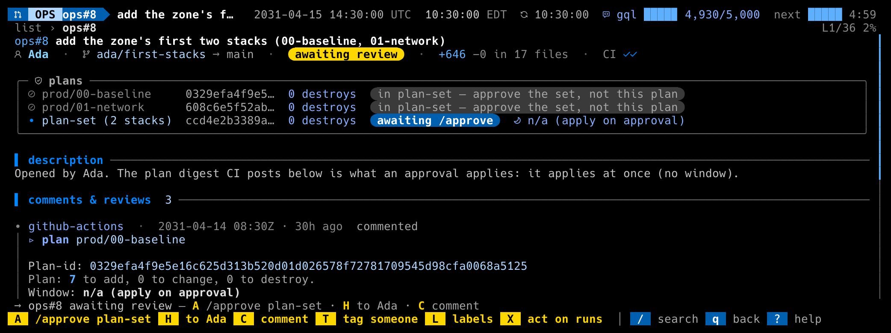
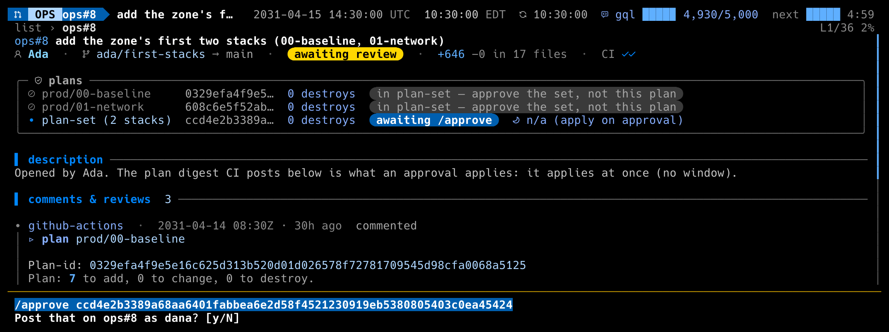
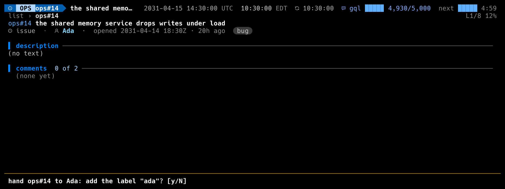
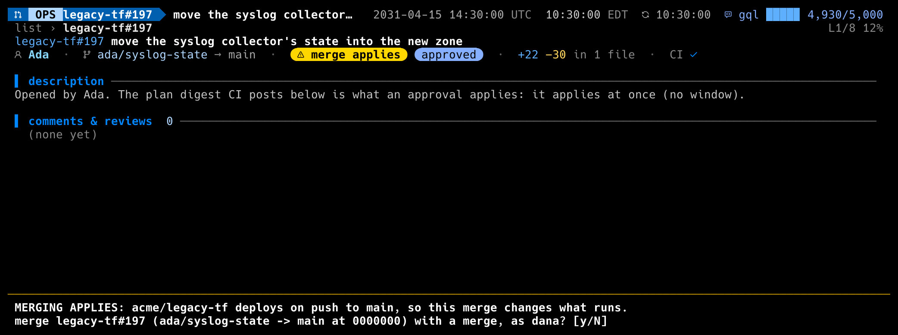

# Working with an AI agent

Some teams work beside an AI agent that opens pull requests, takes issues
and posts in threads. When the agent is a GitHub App, it can't be
@-mentioned into a notification, so it watches a label instead. dillodash
can name the agent, gather its work in one place, and keep the people who
approve it on safe ground. `gh dillodash --demo-agent` replays all of this
offline.

## The config

```toml
[agent]
name = "Ada"                 # what the dashboard calls it: "hand #6 to Ada?"
login = "ada-ops"            # its bot login ("[bot]" optional): its PRs, comments and reviews show the name
handoff_label = "ada"        # H adds it, after a y/N
handoff_comment = ""         # posted with the label, when set
section = true               # a "with Ada" section: its open PRs and the items handed to it

[bots]
logins = ["github-actions", "ada-ops"]   # dillodash refuses to run signed in as the agent

[github]
approvers_team = "acme/ops-approvers"
approvers_team_strict = true             # refuse an /approve that can't be checked
allowed_repos = ["acme/ops", "acme/legacy-tf"]   # write to these only

[reviews]
repos = ["acme/ops", "acme/legacy-tf"]
merge_applies = ["acme/legacy-tf"]       # a merge here deploys: M says so first
```

## The agent's section

The agent's open pull requests, and the open items carrying the handoff
label, move out of the pull request and issue sections into one section
named for the agent. Its pull requests still count toward "need you". An
issue the agent opened stays with the issues: it is the agent's report to
the people.



## Approving what it plans

In a repo that applies on approval (no maintenance window), the plan
card says so, and the key bar leads with what `A` will post: `/approve
plan-set`, `/approve plan` or `/approve ceremony`. With
`approvers_team_strict`, `A` checks the poster is in the team before
anything is sent, and the question names the exact line, the PR and the
poster.





## Handing work to it

`H` on a PR or an issue adds the handoff label after a y/N that names the
agent. The item then appears in the agent's section.



## Repos where a merge applies

A repo listed under `[reviews] merge_applies` carries a "merge applies"
chip in its PRs' header, and `M` says, before anything else, that the
merge changes what runs.


