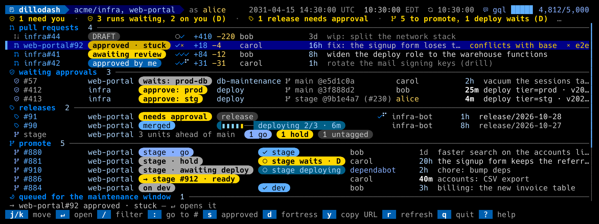
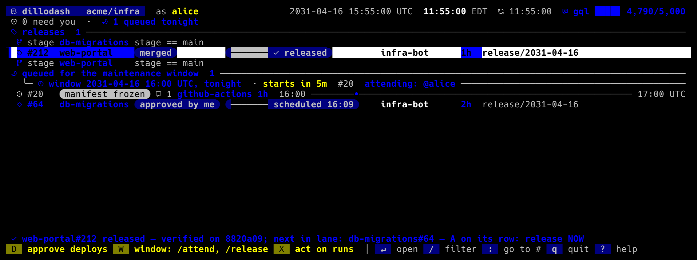
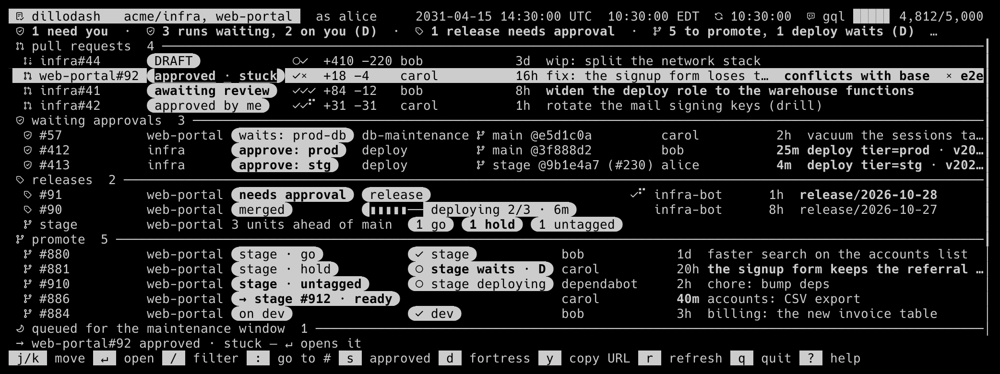
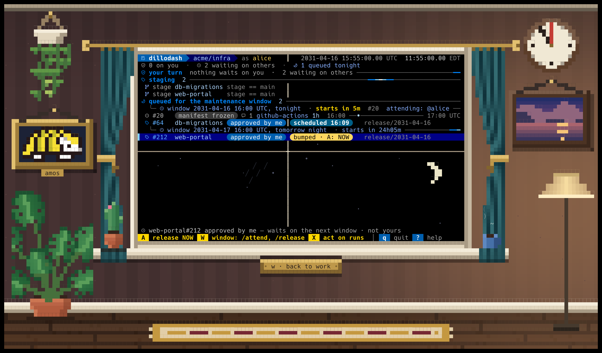
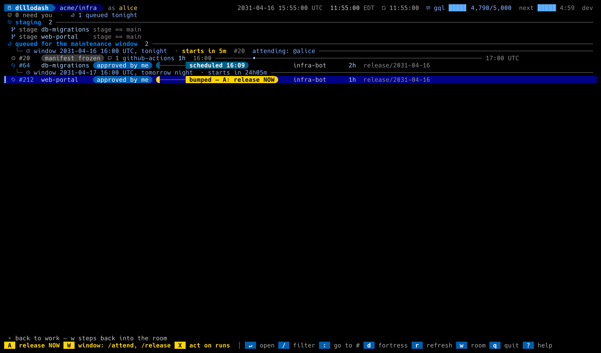
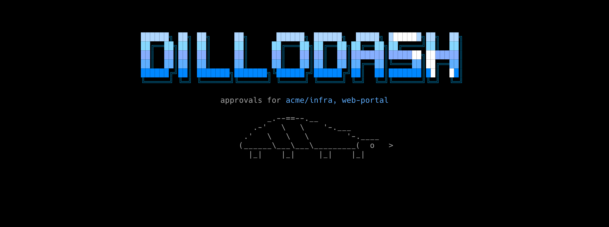
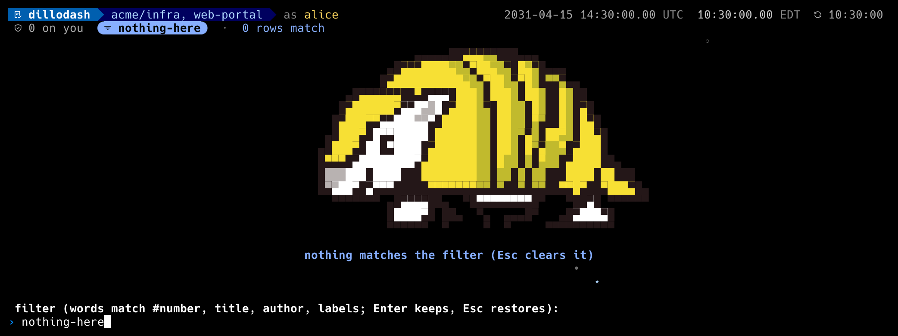

# Display

## Your turn

Every row is someone's move, and the dashboard says whose. A row is
**your move** only when nothing happens until you act: a deploy waiting on
an environment you approve (and not on automation), a release that needs
your approval (not your own), a review requested of you, a promotion of
yours that is ready to merge, your own PR stuck on something only you can
clear. Everything else is **running** (a deploy, a release in flight: you
watch it), **waiting on others** (named: a team, a login, automation, the
next window), **failed**, or **done**.

- **The `your turn` section** is pinned at the top: a copy of every row
  that is your move, most pressing first (deploys, then releases, then
  reviews), each ending with its key and what that key does
  (`D approve prod`). Each row also stands in its own section. With
  nothing to do, one line says so, and what is running or waiting instead.
- **The cursor** starts on the head of the section.
- **`n` and `N`** walk it, next and previous.
- **The summary row** counts the moves in fixed words:
  `3 on you: 2 deploys · 1 release`, `1 running, lands ~23:20`,
  `4 waiting on others`.
- **The hint line** (above the key bar) says it for the selected row: `▸
  #412 — your move (waiting 24m): D approve prod · n next (1 of 3)`, or
  `↻ #90 — deploying 2/3 · nothing for you to do · x follows its log`, or
  `◷ #57 — waits on team dba · not yours`. When the row is not yours and
  something else is, it ends with where `n` goes.
- **Gold** is your move and nothing else. A held staging unit, a bumped
  release (the next window takes it) and a deploy that waits on someone
  else are not gold.
- **The terminal's title** says what waits on you (`[display] title`), so a
  tab or a tmux window shows it while the dashboard is out of sight.

## The list

Columns, left to right: the kind icon and `#number` (`repo#number` with
several repos), the status chip, CI, the diffstat, the author, the age, the
title. Columns drop on a narrow terminal (diffstat first, then age, then
author) so the title keeps at least 24 cells.

**Status chips.**

| Chip | Meaning |
|---|---|
| gold `awaiting review` | needs an approver |
| blue `approved by me` | the row dims and stays in the default list until the PR merges, so approving never makes a PR silently vanish |
| gold-on-gray `changes requested` | |
| gray `DRAFT` | |
| blue `merged` | merged into the production branch |
| workflow chips | `applied, needs review`, `re-planned since queued`, `needs approval`, `not a release`, the window states, a release's rail and a waiting run's `approve: prod` / `waits: prod` come from the workflows; their docs explain them |

The chips keep one meaning each, so a color never has to be read twice:

| Chip | Means |
|---|---|
| pale blue `✓ released` | a release landed and verified; also a deploy run that succeeded |
| steel `scheduled 23:12` | waits for its slot in the window (apart from the deeper blue `approved by me`) |
| bold gold `deploy waiting · D`, `approve: prod` | yours to act on now, with the key that does it |
| rolled `bumped — A: release NOW` | the next window takes it; `A` offers NOW, but nothing waits on you |
| dark gold `✗ release FAILED`, `✗ release refused` | it broke; the card says where |

**A release's rail** is drawn per run phase (setup, validating, merging,
approving envs, deploying, verifying, finishing). On its row it is one pip
a phase: filled blue for a phase done, gold for the one running, a thin
line for the phases to come, and a solid gold block where a release
failed. In its detail it is a stepper, one segment a phase with a gap
between them, so it lines up with the steps listed under it; the running
step is bold with its clock in blue. Amos walks above the rail on a
screen of 32 rows or more; on a shorter one the steps come first, so all
seven fit at 24 rows.

**A night's manifest row** draws the night's timeline in its title's place:
the window from its start to its end as a rule, a mark per slot (a blue
dot scheduled, gold running, a blue block done, a gold block failed) and a
gold bar for now while the window is open. The night's countdown is blue,
gold in its last quarter hour, and `live now` once the window opens; a
narrow screen clips the attendance before the countdown.

**A stage branch ahead of production** reads `3 units ahead of main` with
a small chip per tag that has any: `go` blue, `hold` gold, `untagged`
gray.

PRs approved only by others are hidden by default; `s` shows them.
Approvals made with `A` mark the row instantly, for the head they
approved: a later push clears the mark.

**CI glyphs.** One glyph per check on the head commit:

| | nerd | unicode | ascii |
|---|---|---|---|
| pass | blue octicon check | `√` | `+` |
| fail | gold octicon x, **bold** | `×` | `x` |
| queued | gray circle | `◦` | `.` |
| running | animated braille spinner | same | `~` |
| skipped | dim skip | `−` | `-` |
| not visible to your token | `?` | `?` | `?` |

A failing check appends its name to the row in gold. More than twelve
checks compress to counts (`9+1x2.`).

**Other columns.** Diffstat: `+adds` in blue, `−dels` in gold. Author: you
in gold, bots in blue. Age since the last update, shaded the way `lsd`
shades dates: under an hour bright white, under a day blue, under a week
gray, older dim.

## Rows 0 and 1

**The header** is a powerline bar: `dillodash` on blue, the repos on navy,
then the acting login. On the right are the clock, the refresh time, the
tighter of the token's two hourly budgets as a meter (`gql ████
4,812/5,000` or `rest ...`, gold under 20%), the
countdown to the next refresh as a draining meter, and the version. A
narrow terminal drops the countdown first, then the budget, the refresh
time and the clock; the acting login and the version stay. Inside a PR the
header shows its number and title instead, so what you are acting on stays
visible however far you scroll.

**The clock** reads `2026-11-03 04:12:33.45 UTC  23:12:33.45 EST`: the UTC
date and time, then the same instant in a second zone, New York by default
(`EST`, or `EDT` in summer). `[display] clock_timezone` picks the zone and
`clock_tz_label` its label; `clock = false` hides it. Its width never
changes, so nothing beside it shifts as it runs. The hundredths redraw at
about 30 frames a second; with `motion = "off"` the clock shows whole
seconds and the dashboard wakes once a second for it instead.

**The summary row** counts what is on you (by kind), what runs, what fails
and what waits on others, then failing CI, the window's queue and open
issues, and shows an active filter as a chip. On a narrow
screen the counts with nothing to count go first, then the row ends in an
ellipsis; what needs you always stays. Inside a PR it
is a breadcrumb (`list › #42 › files`) with the scroll position and the
search counter.

**Menus and the help** open over a dimmed screen, so the box is the only
thing in front. A `y/N` question sits on the bottom rows under a gold
rule.

**The status line** (second from the bottom) shows the newest message for
six seconds, or until a newer one replaces it. Results are blue. Refusals
and cancellations (`approve canceled`, `you authored #N`) are gold and
shake once. Errors are gold on a gold chip and stay until something
supersedes them.

## The detail view

The body, comments and reviews render as light markdown. Code blocks sit
on a dark band; terraform plan lines are colored (`+` create blue, `-`
destroy gold, `-/+` replace bold gold, `~` update white, `<=` read gray).
Tables are laid out as columns, sized the way a browser sizes an auto
table, and nothing is ever dropped. `m` shows the source instead.

## Colorblind-safe by design

The palette is grays, blues and golds only: no red and no green. Blue
against gold is the pair red-green colorblindness keeps apart, and the two
differ sharply in lightness, which covers tritan vision. No state depends
on color alone; each has its own glyph or text too. The colors come from
xterm's fixed 256-color cube (rendered exactly on truecolor terminals), so
terminal themes do not remap them, and the background is true black. On a
16-color terminal dillodash uses the ANSI blue and yellow, and a gray chip
is black on light gray so it keeps its shape. With `NO_COLOR`
or `--mono` it uses attributes only, and dims only rules and borders, never
text.

**High contrast, measured.** Every style that draws text clears WCAG
4.5:1 against every background it can land on; rules, borders and icons
clear 3:1. On the navy selection bar and in code bands a dim foreground is
lifted up its own ramp until it clears the floor. The theme's tests check
every style against every background.

Fortress mode is the one exception: it uses Dwarf Fortress's sixteen
colors, including red and green, and every state there also has its own
shape or motion. Amos is drawn in his own colors.

## The room

While the release window is open (the `maintenance_window` workflow's
`release_from` to `end`), dillodash is the view out of a window. The
dashboard shrinks to the glass in the middle of the screen, a cross of
cream mullions runs over it, and the night sky shows wherever the glass is
blank. Around it is the room: a lamp-lit wall, teal curtains tied back on a
brass rod, a monstera in the corner and a pothos hanging over Amos's
portrait, a little landscape and a wall clock with the real time, a cactus
and a mug of coffee on the sill, a rug on the floor. A framed page on the
wall quotes E. M. Forster's *A Room with a View*: Miss Bartlett, promised
south rooms with a view, given north rooms over a courtyard. It hangs
under the clock, below the plaque or over the plant, wherever the wall
holds the whole page; on a terminal too small for that it is left off. With motion on the
plants sway, the steam rises and the second hand sweeps; after five minutes
without a key they rest with everything else.

The dashboard behind the glass is the whole dashboard, laid out to the
glass: every key works, menus and the help open inside it, and a release's
launch fills the room. Nothing in front of the glass covers a letter except
the mullions themselves.

`w` steps out to the plain dashboard (the brass plaque under the window
says so) and back in; while you are out the key bar shows `W room`. The
choice lasts until the window closes, so every night's window opens in the
room again. Outside the window `w` shows the room anyway.

The room needs a terminal of at least 100×30; smaller, the window is the
plain dashboard and `w` says why. With 256 colors or more it is drawn in
half-block pixels and Amos sits for his portrait; a 16-color terminal gets
the nearest colors; with no color or `icons = "ascii"` the room is line
art. `room = false` in `[display]` keeps the window plain (`w` still shows
the room).

## Motion

`--motion full` (the default) animates; `--motion off` or `motion = "off"`
is the static dashboard.

| Where | What moves |
|---|---|
| startup | A splash while the first refresh loads: the logotype lights up row by row under a sweeping shine, Amos rolls in as a ball and uncurls, a scanner runs. At least 1.1 s; any key skips it. |
| list | Rows cascade in on the first load. The selection bar breathes through the blues, and `j`/`k` leave a fading comet tail. A glint ripples across every gold `awaiting review` chip. A gleam runs along each section's rule now and then. |
| refresh | A new PR or issue gets a gold spark in the gutter and its number pulses. An updated row pulses once. A check that just started failing flashes. |
| views | Opening a PR, its files or a diff wipes the new view in from the right behind a soft blue edge; going back wipes from the left. Page-sized scrolls glide; `j`/`k` stay instant. |
| modals | Menus and the help pop open with a band of light round their border. A reason prompt flies a marching gold hazard stripe. |
| status line | Messages type themselves in and fade after 6 s. Refusals shake. |
| posting | A posted approval fires confetti while Amos rolls across the key bar; a comment or a review gets a smaller burst. |
| release | A release posted now launches, for eight seconds. From 256 colors up: the screen folds into a kaleidoscope tunnel of plasma, a rainbow rocket wiggles up it trailing smoke rings and a spiral exhaust, bursts in a rainbow ripple, spiral-galaxy fireworks wheel open, **RELEASED!** drops in letter by letter and sways in rainbow block letters, Amos tumbles through every hue, chaser lights run round the edge, confetti cannons fire, six armadillos stampede the key bar, and the letters melt as the tunnel collapses back into the dashboard. Below 256 colors (or with ASCII glyphs) the classic launch plays in the dashboard's own colors. Any key ends it and still does its own job. |
| empty list | Amos trundles to and fro under a twinkling sky. |
| the room | In the release window the plants sway, steam rises from the mug, the wall clock's second hand sweeps and the stars outside twinkle. |

The rules behind it: nothing a decision rests on animates in; a tick is
never an answer; ambient effects rest after five minutes without a key;
nothing flashes (WCAG 2.3.1: no quarter of the screen swings in
luminance by 10% and back more than three times a second; the launch
cycles every hue at a fixed lightness, and the tests sample every frame
at 30 fps to check); mono terminals keep the moves
without the colors.

## GitHub's budget

Every answer from GitHub carries the token's hourly budgets. The header
shows the tighter of the two. The help (`?`) ends with what this session
has asked of GitHub: calls, the free 304s among them, GraphQL points per
hour, and the reader that spent the most. `--trace-requests FILE` writes
one JSON line per request (the time, who asked, the endpoint's shape with
no repo or number, the status and the points) to measure it.

The dashboard spends the budget on a screen someone reads:

- **Watched**, it refreshes every `refresh_secs` and polls what moves (a
  release in flight, a deploy, a run that waits on you) every 30 seconds.
- **Idle** (no key for `[display] idle_after_secs`), it refreshes half as
  often and polls every two minutes.
- **Out of focus**, it refreshes a third as often and polls every five
  minutes.
- **On return** (a key, or the terminal focused again) it refreshes at
  once, so nobody sees a stale screen.

A deploy is followed by reading its runs, never by whole refreshes. Reads
are conditional, so an answer that did not change costs nothing. When the
budget runs ahead of its hour anyway, the governor slows everything
(`[github] budget_governor`).
