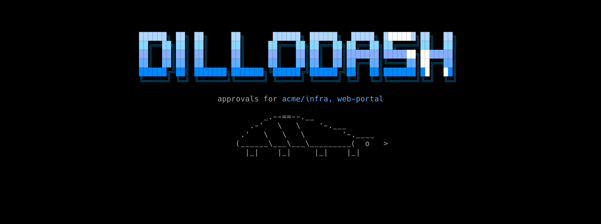
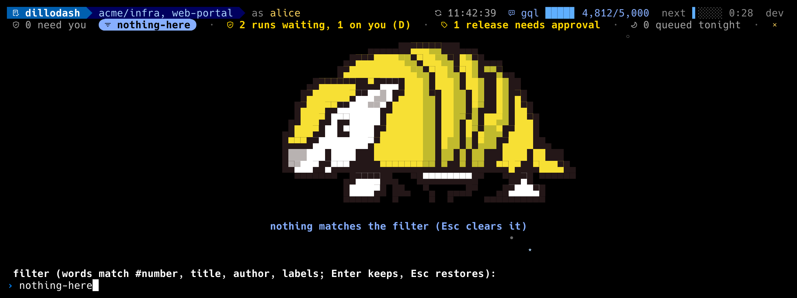

# Display

## The list

Columns, left to right: the kind icon and `#number` (`repo#number` with
several repos), the status chip, CI, the diffstat, the author, the age, the
title. Columns drop on a narrow terminal (diffstat first, then age, then
author) so the title keeps at least 24 cells.

**Status chips.**

| Chip | Meaning |
|---|---|
| gold `awaiting review` | needs an approver |
| blue `approved by me` | the row dims and stays in the default list until the PR merges, so approving never makes a PR silently vanish |
| gold-on-gray `changes requested` | |
| gray `DRAFT` | |
| workflow chips | `applied, needs review`, `re-planned since queued`, `needs approval`, `not a release`, the window states, a release's rail and a waiting run's `approve: prod` / `waits: prod` come from the workflows; their docs explain them |

PRs approved only by others are hidden by default; `A` shows them.
Approvals made with `a` mark the row instantly, for the head they
approved: a later push clears the mark.

**CI glyphs.** One glyph per check on the head commit:

| | nerd | unicode | ascii |
|---|---|---|---|
| pass | blue octicon check | `√` | `+` |
| fail | gold octicon x, **bold** | `×` | `x` |
| queued | gray circle | `◦` | `.` |
| running | animated braille spinner | same | `~` |
| skipped | dim skip | `−` | `-` |
| not visible to your token | `?` | `?` | `?` |

A failing check appends its name to the row in gold. More than twelve
checks compress to counts (`9+1x2.`).

**Other columns.** Diffstat: `+adds` in blue, `−dels` in gold. Author: you
in gold, bots in blue. Age since the last update, shaded the way `lsd`
shades dates: under an hour bright white, under a day blue, under a week
gray, older dim.

## Rows 0 and 1

**The header** is a powerline bar: `dillodash` on blue, the repos on navy,
then the acting login. On the right are the refresh time, the GraphQL
budget as a meter (`gql ████ 4,812/5,000`, gold under 20%), the countdown
to the next refresh as a draining meter, and the version. A narrow
terminal drops the countdown first, then the budget. Inside a PR the header
shows its number and title instead, so what you are acting on stays visible
however far you scroll.

**The summary row** counts what needs you, failing CI, open issues, and the
workflows' own counts, and shows an active filter as a chip. Inside a PR it
is a breadcrumb (`list › #42 › files`) with the scroll position and the
search counter.

**The status line** (second from the bottom) shows the newest message for
six seconds, or until a newer one replaces it. Results are blue. Refusals
and cancellations (`approve cancelled`, `you authored #N`) are gold and
shake once. Errors are gold on a gold chip and stay until something
supersedes them.

## The detail view

The body, comments and reviews render as light markdown. Code blocks sit
on a dark band; terraform plan lines are colored (`+` create blue, `-`
destroy gold, `-/+` replace bold gold, `~` update white, `<=` read gray).
Tables are laid out as columns, sized the way a browser sizes an auto
table, and nothing is ever dropped. `m` shows the source instead.

## Colorblind-safe by design

The palette is grays, blues and golds only: no red and no green. Blue
against gold is the pair red-green colorblindness keeps apart, and the two
differ sharply in lightness, which covers tritan vision. No state depends
on color alone; each has its own glyph or text too. The colors come from
xterm's fixed 256-color cube (rendered exactly on truecolor terminals), so
terminal themes do not remap them, and the background is true black. On a
16-color terminal dillodash uses the ANSI blue and yellow. With `NO_COLOR`
or `--mono` it uses attributes only, and dims only rules and borders, never
text.

**High contrast, measured.** Every style that draws text clears WCAG
4.5:1 against every background it can land on; rules, borders and icons
clear 3:1. On the navy selection bar and in code bands a dim foreground is
lifted up its own ramp until it clears the floor. The theme's tests check
every style against every background.

Fortress mode is the one exception: it uses Dwarf Fortress's sixteen
colors, including red and green, and every state there also has its own
shape or motion. Amos is drawn in his own colors.

## Motion

`--motion full` (the default) animates; `--motion off` or `motion = "off"`
is the static dashboard.

| Where | What moves |
|---|---|
| startup | A splash while the first refresh loads: the logotype lights up row by row under a sweeping shine, Amos rolls in as a ball and uncurls, a scanner runs. At least 1.1 s; any key skips it. |
| list | Rows cascade in on the first load. The selection bar breathes through the blues, and `j`/`k` leave a fading comet tail. A glint ripples across every gold `awaiting review` chip. A gleam runs along each section's rule now and then. |
| refresh | A new PR or issue gets a gold spark in the gutter and its number pulses. An updated row pulses once. A check that just started failing flashes. |
| views | Opening a PR, its files or a diff wipes the new view in from the right behind a soft blue edge; going back wipes from the left. Page-sized scrolls glide; `j`/`k` stay instant. |
| modals | Menus and the help pop open with a band of light round their border. A reason prompt flies a marching gold hazard stripe. |
| status line | Messages type themselves in and fade after 6 s. Refusals shake. |
| posting | A posted approval fires confetti while Amos rolls across the key bar; a comment or a review gets a smaller burst. |
| release | A release posted now launches: a rocket climbs out of the key bar and bursts, a shockwave rolls out, fireworks follow, **RELEASED!** drops in letter by letter, lights march round the edge, confetti cannons fire and six armadillos stampede the key bar. Any key ends it and still does its own job. |
| empty list | Amos trundles to and fro under a twinkling sky. |

The rules behind it: nothing a decision rests on animates in; a tick is
never an answer; ambient effects rest after five minutes without a key;
nothing strobes (no cell changes color more than three times a second,
WCAG 2.3.1, and the tests check the rate); mono terminals keep the moves
without the colors.
