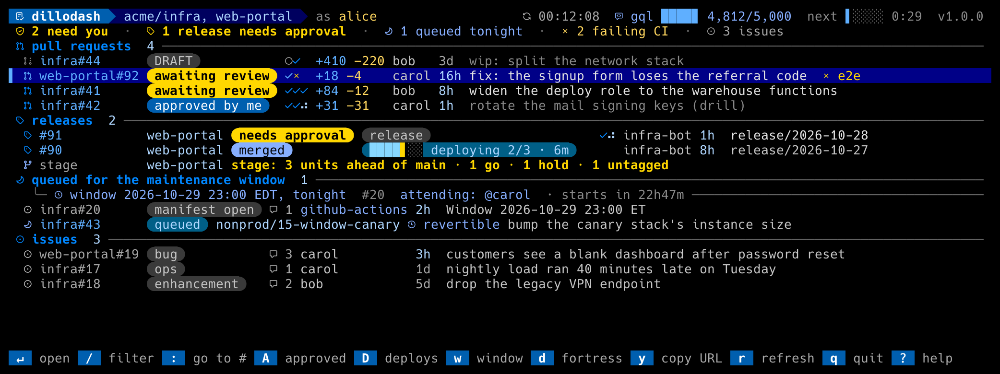
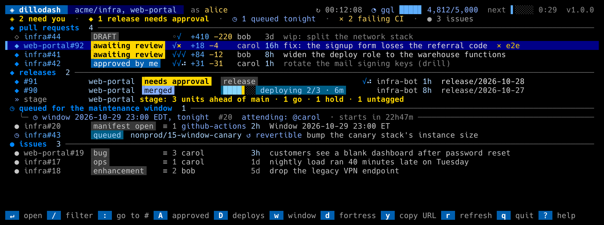
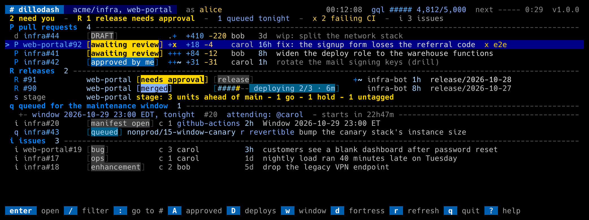

# The terminal font

The dashboard's default icon set, `nerd`, draws its status icons from the
[Nerd Fonts](https://www.nerdfonts.com) Octicons glyphs, which is GitHub's
own icon set. Those glyphs live in the Unicode private-use area, so they
only show if the font your **terminal** uses is a Nerd Font. Without one
they come out as empty boxes or `?`.

The binary embeds **Hack Nerd Font Mono** (Regular and Bold, Nerd Fonts
v3.5.1) and can install it for you. The `Mono` variant matters: it draws
every icon exactly one cell wide, so columns line up. A non-Mono Nerd Font
draws some icons wider and they spill into the next column.

## Install

```sh
gh dillodash font install
```

writes the two font files where your OS looks for per-user fonts, skips any
copy that is already current (byte for byte), never deletes anything, and
needs no network or admin rights. Then set your terminal's font to
**Hack Nerd Font Mono** and run `gh dillodash glyph-test`: the `nerd` column
should show icons, not boxes.

```sh
gh dillodash font check
```

reports which copies are present and current and what `install` would do,
without writing anything.

### What it writes, per OS

| OS | Font files | Also |
|---|---|---|
| macOS | `~/Library/Fonts/HackNerdFontMono-{Regular,Bold}.ttf` | nothing else |
| Linux, BSD | `$XDG_DATA_HOME/fonts/dillodash/` (default `~/.local/share/fonts/dillodash/`) | runs `fc-cache -f` on that directory after a change |
| Windows | `%LOCALAPPDATA%\Microsoft\Windows\Fonts\` | adds one value per file under `HKCU\Software\Microsoft\Windows NT\CurrentVersion\Fonts` (`HackNerdFontMono-Regular (TrueType)` and `-Bold`), the same thing Explorer's "Install" does for a non-admin user; re-asserted on every run |
| WSL | both: the Linux directory above (WSLg terminals) and the Windows one, found through `cmd.exe /c echo %LOCALAPPDATA%` and `wslpath` | registers with Windows as above; Windows Terminal draws WSL, so it needs the Windows copy |

Files are written with mode 0644. After a Windows install, restart Windows
Terminal (sign out and back in if the font still isn't listed). Windows
locks a font that is in use: if a write fails, close the terminal using the
font and run the install again.

WSL needs Windows interop (`cmd.exe` reachable from the Linux side). If it is
off, the install stops and tells you so; copy the two `.ttf` files to Windows
by hand, right-click, Install.

## Over SSH

Fonts render where the terminal runs, not where the dashboard runs. When
`$SSH_CONNECTION` or `$SSH_TTY` is set, `font install` and `font check` print
a note to that effect with ready-made `scp` lines that copy the files it
just installed on the server to your machine:

```
macOS:   scp 'you@server:/home/you/.local/share/fonts/dillodash/HackNerdFontMono-*.ttf' ~/Library/Fonts/
Linux:   scp 'you@server:/home/you/.local/share/fonts/dillodash/HackNerdFontMono-*.ttf' ~/.local/share/fonts/ && fc-cache -f
Windows: copy the two .ttf files there, right-click, Install.
```

If the extension is installed on your own machine too, `gh dillodash font
install` there does the same without the copy.

## Using another Nerd Font

Any Nerd Font works as long as it is a `Mono` variant (the family name ends
in `Nerd Font Mono`, or `NFM`): FiraCode Nerd Font Mono, JetBrainsMono Nerd
Font Mono, and so on. Install it the way you install any font, set it as
your terminal's font, and skip `font install`. Run `gh dillodash glyph-test`
to confirm every icon shows and is one cell wide.

## No font at all: `icons = "unicode"`







If you cannot or do not want to change the terminal font, switch the icon
set. In the config:

```toml
icons = "unicode"
```

or for one run, `--icons unicode`. The `unicode` set uses plain Unicode
symbols that any monospace font has; `ascii` uses only ASCII, for a
terminal that cannot show anything else (nothing detects that: set it).
Every status has its own shape in every set, so nothing depends on the
icons being Nerd Font glyphs.

## Licensing

- **Hack** is MIT-licensed by the Source Foundry Authors, with the
  Bitstream Vera License covering its Vera base (`internal/fonts/LICENSE.md`).
- The **Nerd Fonts** patched fonts are under the SIL Open Font License 1.1
  and the patcher under MIT (`internal/fonts/NERD-FONTS-LICENSE.md`).

`gh dillodash font license` prints both texts, and `font install` writes
them beside the font files as `LICENSE-Hack.md` and `LICENSE-NerdFonts.md`,
so an installed copy carries its notices.
- The icon sets patched into the font carry their own licenses, listed in
  `internal/fonts/NERD-FONTS-README.md`: Octicons (MIT), Codicons and Font
  Awesome (CC BY 4.0), Devicons, Font Awesome Extension, Powerline Extra,
  Powerline Symbols, Power Symbols IEC and Seti (MIT), Material Design
  (Apache 2.0), Pomicons and Weather Icons (OFL 1.1), Font Logos
  (unlicensed), and Hack's own extra glyphs (MIT). The dashboard draws
  Octicons, a few Font Awesome glyphs and the Powerline caps.

The pinned version, checksums and how to re-pin are in
`internal/fonts/README.md`.
