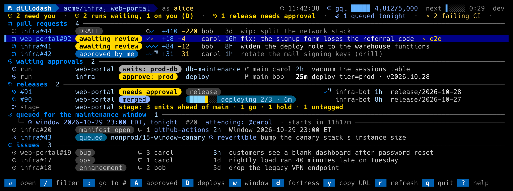
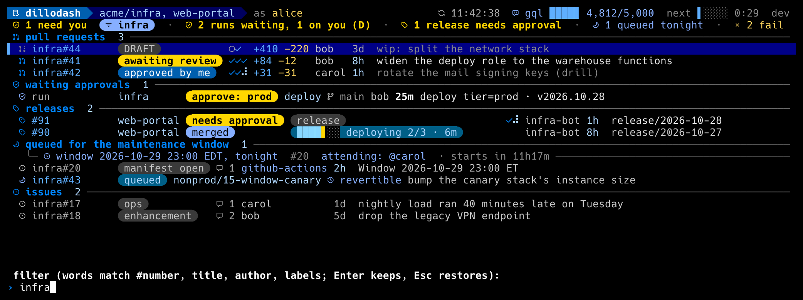
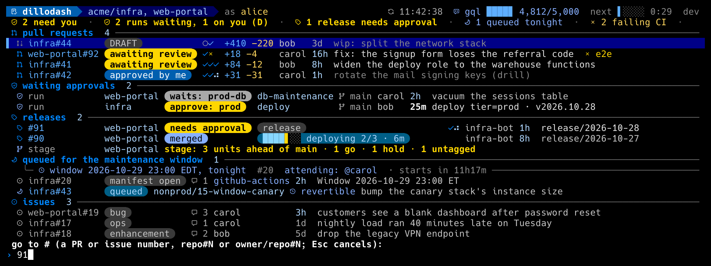
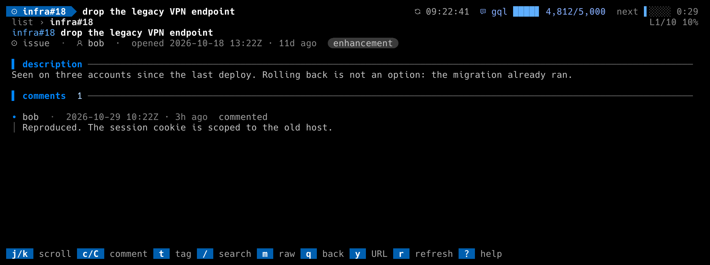
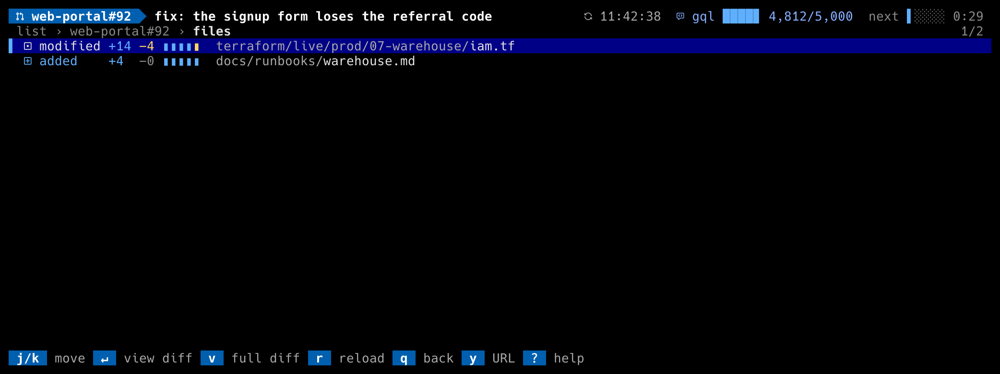
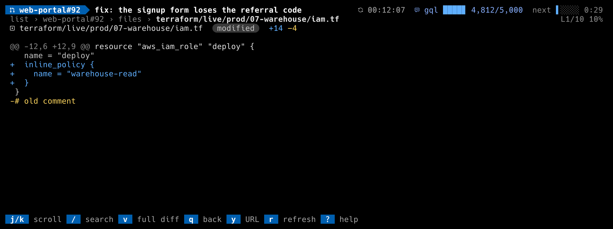
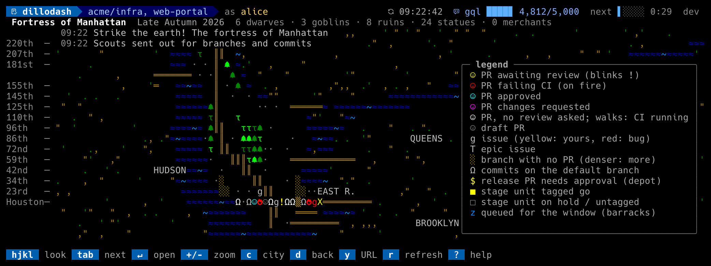

# Keys

<!-- generated from internal/ui/keys.go by `go test ./internal/ui -update`; edit the table, not this file -->

| View | Key | Action |
|---|---|---|
| list, files | `j` / `k` | move the cursor (arrows too) |
| detail, diff | `j` / `k` | scroll a line (arrows too) |
| list, detail, files, diff | `g` / `G` / home / end | top / bottom |
| list, detail, files, diff | pgdn / pgup / space | a page down / up |
| list | enter / `l` | open the PR or issue (`l` and → too) |
| files | enter / `l` | that file's diff in-app (`l` and → too) |
| list | `/` | filter, live as you type: words match the number, title, author, labels and a workflow's own text (a stack, a repo) |
| list | esc | clear the filter (Esc never quits: a stray escape from an Alt chord must not close the dashboard) |
| list | `A` | toggle PRs approved by others (issues are always all shown) |
| list | `D` | approve the deployments waiting on the selected merged PR, or on the selected waiting run (the bar shows it while `release_pr` or `waiting_runs` is on) |
| list | `d` | fortress mode: a Dwarf Fortress map of PRs, issues, branches and commits |
| detail | `a` | approve: a workflow may take over (`/approve` with a plan id, a release's queue-or-now choice); otherwise a GitHub review approval after a confirm |
| detail | `M` | merge the open, approved PR, naming its head so a branch that moved is refused by GitHub; a workflow may refuse or ask its own question first |
| detail | `D` | approve the environment deployments waiting on the open merged PR |
| detail | `c` / `C` | comment inline / in `$EDITOR` |
| detail | `t` | tag someone: pick a repo user, `$EDITOR` opens seeded with the mention, posts as a comment |
| detail | `f` | changed files |
| detail | `v` | the full PR diff in `$PAGER` |
| detail | `/` | search, less-style: smartcase, a `3/17` counter |
| detail | `n` / `N` | next / previous match |
| detail | `m` | raw markdown on/off |
| detail | `q` / `h` / esc | back to the list (`h`, ← and Esc too; Esc first clears a search) |
| files | `v` | the whole PR diff in `$PAGER` |
| files | `r` | reload the file list (not a dashboard refresh) |
| files | `q` / `h` / esc | back to the PR (`h`, ← and Esc too) |
| diff | `/` | search the diff, less-style |
| diff | `n` / `N` | next / previous match |
| diff | `v` | the whole PR diff in `$PAGER` |
| diff | `q` / `h` / esc | back to the files (`h`, ← and Esc too; Esc first clears a search) |
| fortress | `h` / `j` / `k` / `l` | move the look cursor (arrows too) |
| fortress | `H` / `J` / `K` / `L` | move the look cursor by 8 |
| fortress | tab / shift+tab | jump to the next / previous thing |
| fortress | enter | open the PR or issue under the cursor |
| fortress | `+` / `-` / `=` | zoom to a street a day / fit the city (`=` is `+`) |
| fortress | `c` | the other city |
| fortress | `d` / `q` / esc | back to the list (`q` and Esc too) |
| list | `y` | copy the URL (tmux buffer, the system clipboard, or OSC 52); the status line says which |
| list, detail, files, diff, fortress | `o` | open the URL in a browser when this host has one; otherwise like `y` |
| list, detail, diff, fortress | `r` | refresh now (also re-checks CI that already finished, and re-tries a repo whose token was fixed) |
| list | `q` | quit (press twice while an action is still talking to GitHub) |
| any | `:` | go to `#N`, `repo#N` or `owner/repo#N`: a PR first, then an issue |
| any | `?` | help: every key, the glyph legend, the version; `j`/`k` scroll it when it overflows |
| any | `e` | the last status or error message in full (the status line cuts a long one with an ellipsis) |
| any | ctrl+c | quit (interrupt); inside a prompt it cancels the prompt |
| list, detail | `w` | with `maintenance_window`: `/attend`, `/release` or `/window-cancel` on the night's manifest issue, or open it |
| prompts | enter / esc | submit / cancel (Ctrl-C and Ctrl-G cancel too). Ctrl-U, Ctrl-W, Ctrl-K, Ctrl-A/E, arrows, Home/End edit the line; a paste inserts as one edit. A prompt with a minimum length (a reason) counts down and refuses enter until it is met |
| menus | `j`/`k` + enter, `1`–`9` | choose; esc, `q`, Ctrl-C cancel |
| confirms | `y` | anything else is no |

Esc never quits the list: Alt+key and some terminals' Ctrl+arrow sequences
begin with an escape, so a stray one must never quit.

## The screens

Rendered from the offline demo fixture by `go run ./cmd/screenshot`.

**The list**

**`/` filters as you type**

**`:` goes to a number**

**A pull request's detail**

**An issue's detail**

**`f`: the changed files**

**enter on a file: its diff**

**`?`: the help overlay**

**`d`: fortress mode**

