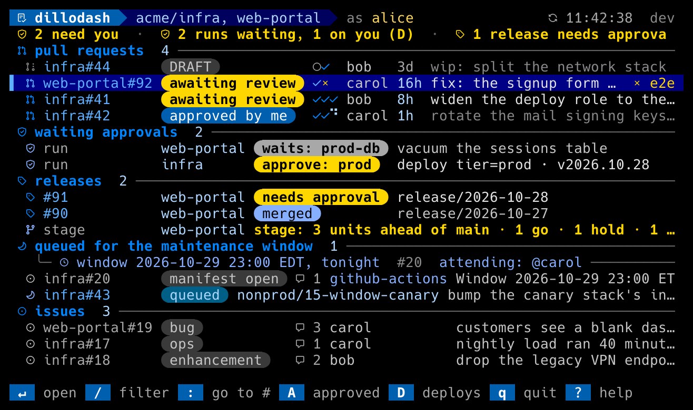
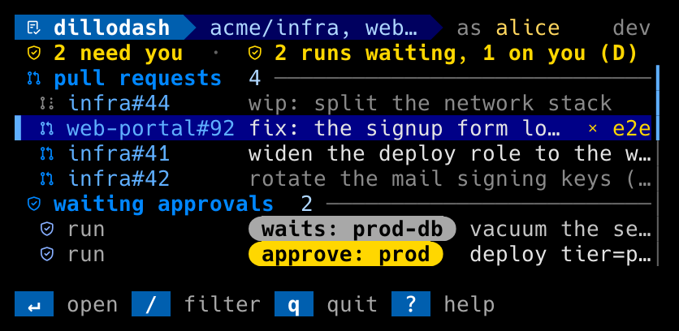

# Troubleshooting

Start with `gh dillodash config check`: it validates the config, shows
which account `gh` is signed in as, and probes what the token can read in
every repo.

| Symptom | Cause / fix |
|---|---|
| `not signed in to <host>` or `GitHub auth failed on <host>` at startup | `gh` is not signed in to the host, or its token expired. `gh auth status`, then `gh auth login` (`--hostname` for GHES). A `GH_TOKEN` or `GITHUB_TOKEN` in the environment overrides the `gh` login; `config check` says which is in use. |
| `signed in as <x>, a bot login` at startup, or `login: FAILED: … is a bot login` in `config check` | The token belongs to a login in `[bots] logins` (or one ending in `[bot]`), usually a CI token leaked into the shell. `unset GH_TOKEN` (or `GITHUB_TOKEN`) to use your `gh` login, or `gh auth switch`. dillodash will not post as a bot. |
| `the dashboard needs a terminal on stdin and stdout` | Output is piped or redirected. `gh dillodash config check` works without a terminal; the dashboard does not. |
| `warning: config expects login "x" but gh is signed in as "y"` | `gh auth switch`, or change `[github] login`. dillodash continues as `y` after a 3-second pause; ctrl-C if that is wrong. |
| Status line: `rate limited by GitHub — refresh paused Ns` | The token hit its hourly budget (or a secondary limit, which pauses for at least a minute), usually a `refresh_secs` set too tight for a busy day. dillodash pauses and resumes by itself; `r` waits too. Raise the interval if it recurs. |
| Warn line: `rate limited — workflow data paused until …` | A workflow's reads hit the wall after the list landed. The list is current; the workflow sections refresh when the window resets. |
| Status line: `degraded: CI via Actions API failed on <repo> … needs Actions: read` | The token lacks the Actions permission on that repo; its CI column shows `?`. The fallback leaves the repo alone until the next `r`, which re-tries it: fix the token, press `r`. A transient failure (a timeout, a 502) keeps the last known CI and is re-tried next refresh. |
| Warn line: `<repo>: GitHub 502 …` with the other repos listed | One chunk of repos failed to load; the rest are current. It is re-tried next refresh. Only when every repo fails does the whole refresh fail. |
| CI column empty for a PR | No workflow runs exist for that head (a docs-only change). Distinct from `?`, which means not visible. |
| Warn line: `issues hidden — token needs Issues: read` | The token cannot read issues, so the section is empty. Add the permission. |
| Status line: `repository not visible to this token` | A repo in `[reviews]` is mistyped, or a fine-grained token is still pending org approval or lacks the grant. |
| List says `couldn't load … retrying in Ns` | The refresh failed for every repo (network, 5xx). It retries in 15 s, 30 s, 60 s … up to the refresh interval; `r` retries now. |
| A status or error line ends in `…` | It was wider than the terminal. `e` opens the whole message in an overlay. |
| Ctrl-C inside `$PAGER` or `$EDITOR` | Returns to the pager or editor as usual; the dashboard is not affected. Ctrl-C on the dashboard itself quits it (exit 130); `q` during an action warns once and quits on a second press. |
| Empty boxes or `?` where icons should be | The terminal's font is not a Nerd Font. `gh dillodash font install`, select "Hack Nerd Font Mono" in the terminal, or `icons = "unicode"`. `gh dillodash glyph-test` shows every glyph. |
| Icons overlap the next column | The font is a Nerd Font but not a **Mono** variant: its icons are wider than one cell. |
| Background looks dark gray, or colors look off | The terminal does not advertise its colors. Use a `TERM` of `xterm-256color` or `tmux-256color`, or set `COLORTERM=truecolor` where the terminal supports it. |
| `y` says `the terminal via OSC 52 (if it allows it)`, but the clipboard is empty | No clipboard tool was found (`pbcopy`, `clip`, `wl-copy`, `xclip`) and the terminal ignores OSC 52, or an old tmux lacks `load-buffer -w`. The URL is on the status line to copy by hand. |
| `write: NO (READ)` or `write: FAILED: every review repo is read-only` in `config check` | The signed-in account has no push on that repo, so `a`, `c`, `M` and `D` would 403. `gh auth switch` to the right account, or ask for write access. `write: not reported` means a fine-grained token, whose grants GitHub does not report as a role; a 403 names a missing grant when it happens. |
| `M` or `D` answers `403 … not accessible by personal access token` | The token needs Contents (merge) or Deployments (approvals) read and write on that repo. The message names it. |
| A merged PR says `stuck? …` | A run on its merge commit has been queued or running longer than `deploy_stuck_secs` (45 minutes by default). Check it in that repo's Actions; dillodash only reads runs, never cancels or re-runs them. |
| The `releases` section is missing a repo enrolled today | Discovery is cached for a day. Delete `$XDG_CACHE_HOME/dillodash/release-repos-<org>.json` (default `~/.cache/dillodash/`) and press `r`. |
| A run waiting on an environment is not in `waiting approvals` | Its repo is not in `[workflows.waiting_runs] repos`, the warn line says the token cannot read its Actions, or it runs on the merge commit of a merged PR the dashboard lists (a review PR, or a release): then it is that PR's, and `D` on the PR approves it. A run on an open PR's head is listed. |
| Release rows show no CI | The token cannot read the check rollup and lacks `Actions: read` on the release repos; grant it. Release rows use the same Actions fallback as the review list. |
| Too much motion, or a slow SSH link | `--motion off` (or `motion = "off"`). Ambient effects rest by themselves after five minutes without a key. |
| Detail header says `last 100 of N comments` | GraphQL returns at most 100 comments, the newest. Older ones (and digests in them) are not seen; read the thread on GitHub. |
| A workflow's command "bounced" | dillodash posts the comment; the bot still validates it and replies on the PR or issue. The reply is shown on the next refresh. |

## Small terminals

The layout folds as the terminal narrows: the diffstat and the author go
first, then the CI glyphs; the titles and the key bar's `?` stay to the
last.

