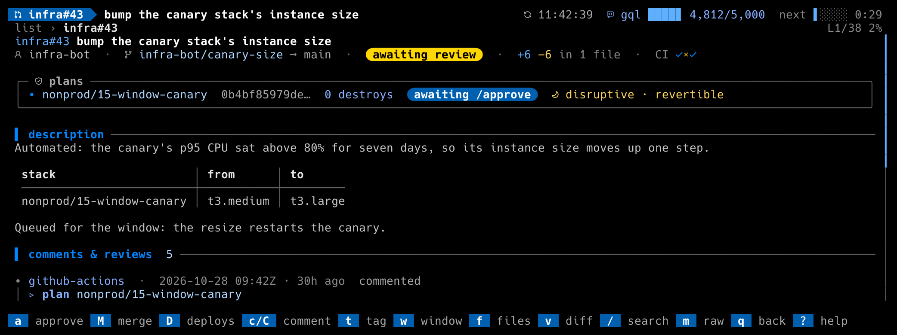

# The `maintenance_window` workflow

For organizations that apply disruptive changes in a nightly window run by
a **conductor** bot: an approved disruptive change is labeled and queued,
a manifest issue per night lists the slots, and people check in with
commands on that issue. dillodash shows the queue by night and posts the
commands.

```toml
[workflows.maintenance_window]
enabled = true
manifest_repo = "acme/infra"      # where the manifest issues live
timezone = "America/New_York"
cutoff = "21:00"                  # last moment to /attend
start = "23:00"                   # the window opens
release_from = "22:59"            # /release counts from here
end = "23:30"
```

Every label, command and time has a key in `config.example.toml`. Every
time on screen is formatted in the configured zone with its abbreviation
(`23:00 EDT`); the examples below assume the defaults.

## What you see



- **The section** `queued for the maintenance window` sits below the pull
  requests. It is grouped by the night each item will run in, the next
  window first. A terraform row shows the status (`queued`, `scheduled
  23:04 EDT` once the freeze has slotted it, or `rolled: <reason>`), the
  stack, and `revertible` or **`attended night needed`** for an item that
  runs only when someone posts `/attend` and `/release` on that night's
  manifest. A release row (with `release_pr` and
  `approval_queues_for_window`) keeps the release workflow's chips:
  `scheduled 23:04` (no zone) once slotted, `waiting for slot`, then its
  rail once it runs.
- **The night's manifest issue is the first row under its sub-header**
  (chip `manifest <phase>`), never a loose row in `issues`. `enter` opens
  it, `o` opens it in the browser, `w` acts on its night.
- **The sub-header** names the manifest, counts down to the start
  (`starts in 2h03m`), and shows who attends and who checked in. When a
  held item needs someone, it says so in gold: `needs /attend (w) by
  21:00 EDT` before the cutoff, `nobody attending: not-revertible items
  roll` after it, `/release now (w) by 23:10 EDT` from `release_from`.
- **A queue entry a later push killed goes back to the pull-request list.**
  The queued label stays on a PR until the freeze re-validates it, so
  dillodash compares the queue notice's plan id with the PR's plans: still
  one of them, the row stays; dead with no `/approve` on the new plan, the
  PR moves back as gold `re-planned since queued` and counts in "need you";
  dead but a newer plan is approved or applied, it moves back with its
  ordinary chip.
- **The summary row** counts `N queued tonight`.

## `w`

From the list (on a queued terraform row, a release row under a night, or a
manifest row), from a queued PR's or release's detail, or from the
manifest's own detail, `w` opens a menu for that night, or the next night
with a manifest: `/attend`, `/release`, `/window-cancel <id>` (only for the
selected item: `#N` for a terraform PR, `rel:<repo>#<N>` for a release),
open the manifest issue. Each entry says why it would or would not count
now, using the conductor's own rules: `/attend` only before the cutoff;
`/release` only from an attendee, from `release_from` to `end`; a cancel
only before the item starts or while it waits for `/release`. A release
joins the manifest only at the freeze, and the conductor refuses a cancel
for a `rel:` id the manifest does not list, so before the cutoff the
release's cancel entry is marked `(not now)` and says what takes it out
instead: a Request changes review on the release PR. A command the
conductor would refuse posts nothing and says why. Anything else asks y/N,
then posts the plain command as a comment on the manifest. dillodash
refreshes 45 seconds after posting and reads the conductor's reply.

dillodash does not check who may run window commands: the conductor does.
When `team` is set, the menu title names it (`commands count only from
@org/team`); a command from someone outside it is posted, and the
conductor's reply refuses it.

Posting needs the token's Issues read and write, because the manifest is
an issue.

## The protocol the conductor must speak

**Labels** on a queued pull request: `queued_label` (default
`window:queued`) when queued; `scheduled_label` (`window:scheduled`) once
the freeze gave it a slot; `rolled_label` (`window:rolled`) when it rolled
to a later night; on a release the conductor ran, `applied_label`
(`window:applied`) when it verified, `failed_label` (`window:failed`)
when it did not, and `pending_label` (`window:pending`) when it merged and
its deploy waits on an environment approval (the release workflow's live
progress reads them).

**The queue notice**, a comment by `conductor_bot` on the PR when it is
queued:

```
<!-- window-queue {"night": "2026-10-22", "plan_id": "<64 hex>", "stacks": ["prod/07-warehouse"], "queued_at": "2026-10-21T18:02:00Z", "revertible": true} -->
```

**The manifest issue**, one per night in `manifest_repo`: labeled
`manifest_label` (`window-manifest`), titled by `manifest_title` with the
night's date (`Window {night}` by default; set `manifest_title` to the bot's exact title), and carrying a machine block in
its body:

```
<!-- window-manifest:begin
{"night": "2026-10-22", "phase": "open", "attendees": ["carol"],
 "items": [{"id": "#42", "repo": "infra", "pr": 42, "flag": "scheduled",
            "revertible": false, "start_utc": "2026-10-23T03:04:00Z",
            "release_by_utc": "2026-10-23T03:14:00Z",
            "status": "waiting for /release until 2026-10-23T03:14:00Z", "reasons": []}]}
window-manifest:end -->
```

Phases are `open`, `frozen`, `running`, `ran`, `skipped`, `closed`. Item
ids are `#N` for a PR in the manifest repo and `rel:<repo>#<N>` for a
release from another repo. When two manifests exist for a night, the lowest
issue number wins.

**Commands** dillodash posts on the manifest (the names are configurable):
`/attend`, `/release`, `/window-cancel #N` or `/window-cancel rel:<repo>#<N>`.

**Replies** dillodash recognizes, by their first line:

| Reply | Meaning |
|---|---|
| `@login is attending the night of …` | attending |
| `` `/attend` from @login is after the cutoff `` | too late |
| `@login: only members of @org/team can run window commands` | not a team member |
| `` @login: `/release` counts only from someone who posted `` | not an attendee |
| `Checked in: @login.` | checked in |
| `` `/release` counts from … `` | too early |
