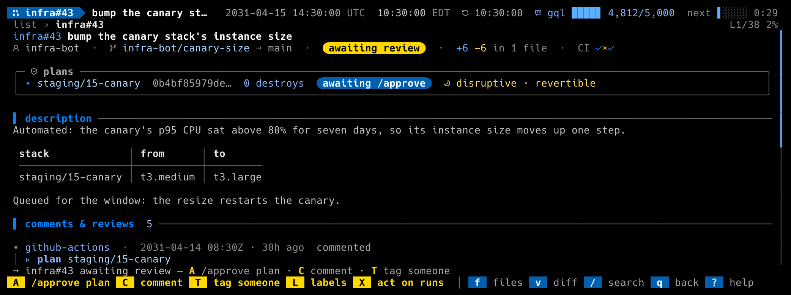

# The `maintenance_window` workflow

For organizations that apply disruptive changes in a nightly window run by
a **conductor** bot: an approved disruptive change is labeled and queued,
a manifest issue per night lists the slots, and people check in with
commands on that issue. dillodash shows the queue by night and posts the
commands.

```toml
[workflows.maintenance_window]
enabled = true
manifest_repo = "acme/infra"      # where the manifest issues live
timezone = "UTC"
cutoff = "12:00"                  # last moment to /attend; the freeze
start = "16:00"                   # the window opens
release_from = "15:55"            # /release counts from here
end = "17:00"
```

The times are the shipped example, not a recommendation: set your
conductor's. Every label, command and time has a key in
`config.example.toml`. Every time on screen is formatted in the
configured zone with its abbreviation (`16:00 UTC`); the examples below
assume the example window.

## What you see



- **The section** `queued for the maintenance window` sits below the pull
  requests. It is grouped by the night each item will run in, the next
  window first. A terraform row shows the status (`queued`, `scheduled
  16:04 UTC` once the freeze has slotted it, or `rolled: <reason>`), the
  stack, and `revertible` or **`attended night needed`** for an item that
  runs only when someone posts `/attend` and `/release` on that night's
  manifest. A release row (with `release_pr` and
  `approval_queues_for_window`) keeps the release workflow's chips:
  `scheduled 16:04` (no zone) once slotted, `waiting for slot`, then its
  rail once it runs. A release whose head moved after the freeze (a
  re-cut) reads `rolled · re-cut`: the freeze froze the old head
  (the item's `head_sha`), so the slot will not run it, and a fresh
  approval joins a later night; release NOW is the way to ship it
  tonight.
- **The night's manifest issue is the first row under its sub-header**
  (chip `manifest <phase>`), never a loose row in `issues`. `enter` opens
  it, `o` opens it in the browser, `w` acts on its night. In its title's
  place (the title repeats the night above it) it draws the night's
  timeline: the window from its start to its end, a mark per slot in run
  order (a blue dot scheduled, gold running, a blue block done, a gold
  block failed) and a gold bar for now while the window is open. With no
  slot yet and the window not open, it says what the row is for.
- **The sub-header** names the manifest, counts down to the start
  (`starts in 2h03m`: blue, gold in the last quarter hour, `live now` once
  the window opens; a narrow screen clips the attendance before it), and
  shows who attends and who checked in. When a
  held item needs someone, it says so in gold: `needs /attend (w) by
  12:00 UTC` before the cutoff, `nobody attending: not-revertible items
  roll` after it, `/release now (w) by 16:10 UTC` from `release_from`.
  With `closer` set, a night past its `end` that is not closed yet says
  `closes at <closer>`, then `closer late`.
- **A missed freeze.** When the freeze never ran, the conductor fires
  nothing that night. dillodash shows a gold `missed freeze` chip and the
  recovery (`missed_freeze_hint`) on the night, and `w` stops offering
  `/attend` and `/release` there. It tells by the conductor's comment
  carrying `missed_freeze_marker` (`MISSED FREEZE`), or by the manifest
  still `open` `missed_freeze_grace_mins` (30) after the cutoff. A
  `/window-cancel` is still offered.
- **A queue entry a later push killed goes back to the pull-request list.**
  The queued label stays on a PR until the freeze re-validates it, so
  dillodash compares the queue notice's plan id with the PR's plans: still
  one of them, the row stays; dead with no `/approve` on the new plan, the
  PR moves back as gold `re-planned since queued` and counts in "need you";
  dead but a newer plan is approved or applied, it moves back with its
  ordinary chip.
- **The summary row** counts `N queued tonight`.

## `w`

From the list (on a queued terraform row, a release row under a night, or a
manifest row), from a queued PR's or release's detail, or from the
manifest's own detail, `w` opens a menu for that night, or the next night
with a manifest: `/attend`, `/release`, `/window-cancel <id>` (only for the
selected item: `#N` for a terraform PR, `rel:<repo>#<N>` for a release),
open the manifest issue. Each entry says why it would or would not count
now, using the conductor's own rules: `/attend` only before the cutoff;
`/release` only from an attendee, from `release_from` to `end` (with
`late_skip` set, it says nothing new starts after it); neither on a
missed freeze; a cancel
only before the item starts or while it waits for `/release`. A release
joins the manifest only at the freeze, and the conductor refuses a cancel
for a `rel:` id the manifest does not list, so before the cutoff the
release's cancel entry is marked `(not now)` and says what takes it out
instead: a Request changes review on the release PR. A command the
conductor would refuse posts nothing and says why. Anything else asks y/N,
then posts the plain command as a comment on the manifest. dillodash
refreshes 45 seconds after posting and reads the conductor's reply.

The conductor decides who may run window commands. When `team` is set,
the menu title names it (`commands count only from @org/team`). With
`[github] approvers_team` set, dillodash also checks the posting login is
a member before it posts, and refuses otherwise, naming the login (see
[release-pr.md](release-pr.md#a-manual-release-night)); without it, a
command from someone outside the team is posted and the conductor's reply
refuses it. A bot login is never posted as.

Posting needs the token's Issues read and write, because the manifest is
an issue.

## Reserved stacks

Some conductors also refuse an *immediate* apply to the stacks the
window owns for a span around it, even a harmless one, unless the command
carries the outside-window flag. Tell dillodash the span and the stacks:

```toml
reserved_from = "15:50"           # with reserved_to; a span past midnight wraps
reserved_to = "17:15"
reserved_stacks = ["prod/*"]      # path patterns; [] = every stack
```

Inside the span, `a` on a plan that is not disruptive but goes to a
reserved stack asks first: wait until `reserved_to` (the first entry), or
apply now with `outside_window_flag` and a reason, as for a disruptive
plan. Outside the span, or on another stack, nothing changes.

## The protocol the conductor must speak

**Labels** on a queued pull request: `queued_label` (default
`window:queued`) when queued; `scheduled_label` (`window:scheduled`) once
the freeze gave it a slot; `rolled_label` (`window:rolled`) when it rolled
to a later night; on a release the conductor ran, `applied_label`
(`window:applied`) when it verified, `failed_label` (`window:failed`)
when it did not, and `pending_label` (`window:pending`) when it merged and
its deploy waits on an environment approval (the release workflow's live
progress reads them).

**The queue notice**, a comment by `conductor_bot` on the PR when it is
queued:

```
<!-- window-queue {"night": "2026-10-22", "plan_id": "<64 hex>", "stacks": ["prod/07-warehouse"], "queued_at": "2026-10-21T18:02:00Z", "revertible": true} -->
```

**The manifest issue**, one per night in `manifest_repo`: labeled
`manifest_label` (`window-manifest`), titled by `manifest_title` with the
night's date (`Window {night}` by default). `{hhmm}` in the title is the
window's start, and any `HH:MM` in it, literal or `{hhmm}`, matches any
time, so a manifest opened before the start time changed is still read.
It carries a machine block in its body:

```
<!-- window-manifest:begin
{"night": "2026-10-22", "phase": "open", "attendees": ["carol"],
 "items": [{"id": "#42", "repo": "infra", "pr": 42, "flag": "scheduled",
            "revertible": false, "start_utc": "2026-10-22T16:04:00Z",
            "release_by_utc": "2026-10-22T16:14:00Z", "head_sha": "<40 hex>",
            "status": "waiting for /release until 2026-10-22T16:14:00Z", "reasons": []}]}
window-manifest:end -->
```

Phases are `open`, `frozen`, `running`, `ran`, `skipped`, `closed`. Item
ids are `#N` for a PR in the manifest repo and `rel:<repo>#<N>` for a
release from another repo. `head_sha`, when present, is the head the
freeze froze. When two manifests exist for a night, the lowest issue
number wins. A conductor comment carrying `missed_freeze_marker` marks a
night the freeze never ran.

**Commands** dillodash posts on the manifest (the names are configurable):
`/attend`, `/release`, `/window-cancel #N` or `/window-cancel rel:<repo>#<N>`.

**Replies** dillodash recognizes, by their first line:

| Reply | Meaning |
|---|---|
| `@login is attending the night of …` | attending |
| `` `/attend` from @login is after the cutoff `` | too late |
| `@login: only members of @org/team can run window commands` | not a team member |
| `` @login: `/release` counts only from someone who posted `` | not an attendee |
| `Checked in: @login.` | checked in |
| `` `/release` counts from … `` | too early |
