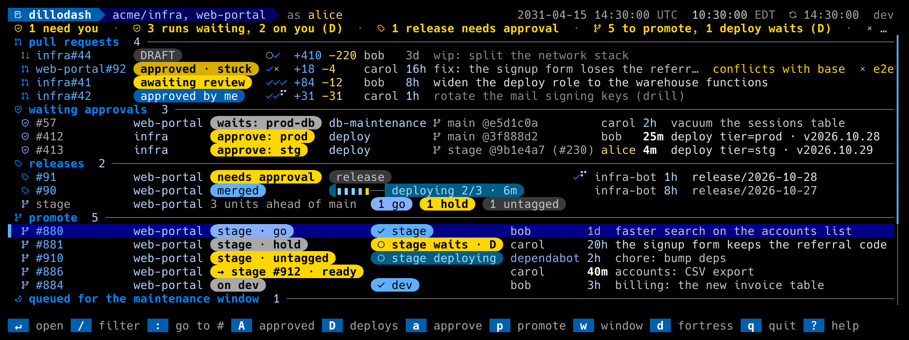
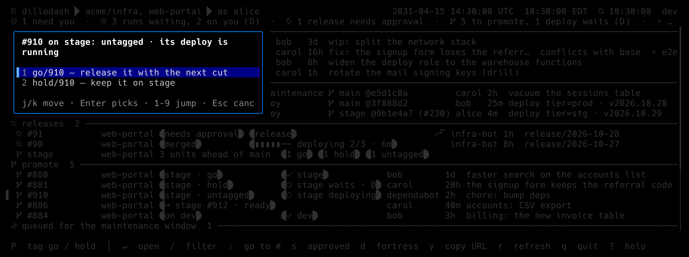

# The `promote` workflow

For repositories with a branch per tier: a feature PR lands on a **first
tier** (`dev`), a promotion PR carries it to a **staging tier** (`stage`),
where the unit gets a `go/<N>` or `hold/<N>` tag, and the release PR
carries the go units to **production** (`main`). Each push to a tier
branch runs that tier's deploy.

The [`release_pr`](release-pr.md) workflow covers the last hop. This one
covers everything before it. Each change gets one row from the moment it
merges into the first tier until it reaches production. The row says
where the change is and what its tier's deploy did. `p` moves the change
one tier on, and `D` approves the deploy its tier waits on.

```toml
[workflows.promote]
enabled = true
repos = ["acme/web-portal", "acme/db-migrations"]
tiers = ["dev", "stage", "main"]       # first, staging, production
first_tier_reviews = "open"            # every open PR into dev joins the list
```

## Configuration

| Key | Default | Meaning |
|---|---|---|
| `enabled` | `false` | Turn the workflow on. |
| `repos` | every `[reviews]` repo | The branch-per-tier repos, as `"owner/name"`. A repo in neither `[reviews] repos` nor `requested_repos` is a warning: its open first-tier PRs would not be listed. |
| `tiers` | `["dev", "stage", "main"]` | The three branches in order: first, staging, production. Staging and production should match `release_pr`'s `staging_branch` and `production_branch` (a warning says when they don't). |
| `first_tier_reviews` | `"requested"` | Which open PRs into the first tier the pull requests section lists for a repo in `requested_repos`. `"requested"` lists the PRs that ask for your review, that you reviewed, or that you opened, like any requested repo. `"open"` lists every open, non-draft PR into the first tier that a GitHub App (dependabot and the like) didn't open, whether or not a review was requested. An agent's account counts, even when `[bots]` lists it: its PRs are the ones that never ask for a review. A repo in `[reviews] repos` already lists every PR. |
| `lookback_days` | `14` | How far back the merged PRs are read (1 to 90). A change merged into the first tier earlier than this and never promoted drops off the list. |
| `go_tag_prefix`, `hold_tag_prefix` | `release_pr`'s, else `"go/"`, `"hold/"` | A staging unit's tags. |
| `branch_prefix` | `"promote/"` | A promotion branch is `<prefix><number>-<staging tier>`, for example `promote/206-stage`. |
| `approval_comment` | `"dillodash: approved {workflow} run {run} in {repo}"` | The comment GitHub records with a deployment `D` approves from a promote row. |

### Why `"open"` and not "needs my review"

GitHub marks a PR as needing review only when a branch rule requires an
approval, or a `CODEOWNERS` file names a reviewer. Many first-tier branches
have neither, so a PR that needs a person's eye in practice (an agent's PR,
a migration) never asks for it, and `requested` never lists it. `"open"`
lists all of them. The cost is a busier list, which is the point on a repo
whose first tier is where review happens.

## What you see



The **`promote` section** sits under the releases. It has one row per
change, the changes furthest along first:

- **Columns.** The change's PR number, the repo, where it is, its tier's
  deploy, who opened it, how long it has been on its tier, and the title.
  The number is the first-tier PR's. A staging unit with no first-tier PR
  in view uses its own number.
- **Where it is:**
  - `on dev`: merged into the first tier, not yet promoted.
  - `→ stage #912 · ready`: an open promotion PR carries it. The suffix is
    GitHub's merge state: `ready`, `checks`, `behind`, `conflicts` or
    `draft`.
  - `stage · untagged` (gold), `stage · hold`, `stage · go` (green), or
    `stage · go · after #905`. The last means a unit ahead of it isn't
    go, so the release cut stops there.
- **The deploy chip.** The newest run of each workflow on the tier's
  commit, summed up: `dev ✓`, `stage deploying`, `stage waits · D`
  (gold), `stage ✗ <workflow>`, or nothing when no run is on the commit
  (a repo deployed by something other than Actions).
- **The header** counts `N to promote`, gold with `, M deploy waits (D)`.
- Enter opens the first-tier PR, or the promotion PR while it is open. `o`
  and `y` open or copy its URL. `/` matches the repo, the number, the
  title, the author, the tier and the tag.

A change reaches production when its staging unit's commit is no longer
ahead of production. It then leaves the list. Back-merges (a PR from
staging or production into a lower tier) are not changes.

### How a change is followed

- **First tier to staging.** A staging PR carries a first-tier PR when it
  names it: `#206` in its title or body. A reference to another repo,
  such as `acme/other#206`, doesn't count. A whole-tier promotion (a
  staging PR whose head is the first tier itself) carries every
  first-tier PR whose merge commit is on its head's history. dillodash
  asks GitHub's compare for that and keeps the answer.
- **Staging to production.** A staging unit is the commit its PR left on
  staging (the merge or squash commit). The unit's tag is
  `go/<staging PR number>` or `hold/<staging PR number>`, as the release
  cut reads it.

## `p`



`p` on a change moves it one tier on. What that means depends on where
the change is.

| Where | `p` does |
|---|---|
| `on dev` | **Opens the promotion PR.** It reads the change's merge commit and checks each file against the staging head. A file is taken when staging still has what the first tier had before the change, or already has the result. Any other file is a conflict, and `p` refuses with the files named: promote what the change depends on first, or promote it by hand. Nothing is merged three-way. After a confirm, `p` creates `promote/<N>-stage` from the staging head, commits the change there in one commit that GitHub signs (`createCommitOnBranch`, so a signed-commits rule holds), and opens the PR `Promote #N to stage: <title>`. If the commit fails, the branch is deleted again. If the branch already exists, `p` says so and writes nothing. |
| `→ stage` | **Merges the promotion PR** once GitHub says it can (`ready`), with `[merge] methods` for the repo. `checks`, `behind`, `conflicts` and `draft` are said, not forced. The merge's push deploys staging. |
| `stage · …` | **Tags the unit.** A menu offers `go/<N>` (release it with the next cut) and `hold/<N>` (keep it on stage), minus the current tag. Before a go, the confirm says what staging's deploy of the unit did, and asks again unless it passed. Then a tag message (prefilled), and a last confirm. A flip deletes the other tag first. The tag is annotated, on the unit's commit, with "Tagged with dillodash by <you>." in its message. |
| `stage · go` | Tagging is still offered (`hold`). The menu's title says the last hop: the open release PR into production that carries it (`a` approves it there), the unit ahead of it that holds the cut, or the next release cut. |

Every `p` write passes the same guards as the other keys. `allowed_repos`
refuses it outside the list, and a `[bots]` login or a login outside
`approvers_team` posts nothing. A newer installed release is offered
first. The release itself keeps its own rules (`release_pr`, the
maintenance window).

## `D`

`D` on a change row approves the deploy its tier waits on. It finds the
runs on the tier's commit that wait on an environment, offers a choice
when there are several, and reads the environments again. It then
approves the ones you can approve (GitHub's `current_user_can_approve`,
which counts a team you are in) after a confirm, with `approval_comment`.
An environment you can't approve is named, not tried. While a change sits
in a promotion PR, `D` says that its checks are on the PR.

## Refresh and cost

Each refresh, for each repo, costs:

- **One GraphQL request** of three searches: PRs merged into the first
  tier since `lookback_days`, PRs merged into staging since then, and
  open PRs into staging. A search that hits its page of 50 is a warning.
- **One compare** of production and staging.
- **Two tag listings.**
- **The runs on each listed change's tier commit.** A commit whose runs
  have all finished is read once, then cached.
- **An ancestry compare** for each first-tier PR that only a whole-tier
  promotion can carry, once per pair (the answer never changes).

A repo that can't be read keeps its last rows, with a warning. A rate
limit pauses the workflow with the rest of the dashboard.

## Permissions

The token needs these grants on every repo in `repos`:

- **Contents read, Pull requests read and Actions read** to list.
- **Contents read and write** to create the branch, the commit and the
  tags.
- **Pull requests read and write** to open and merge the promotion PR.
- **Deployments read and write** for `D`.

See [auth.md](../auth.md).
