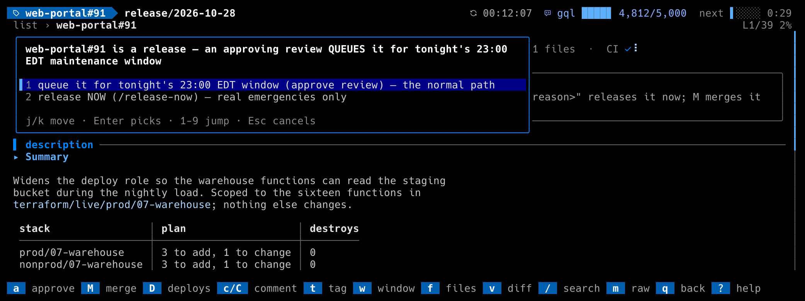
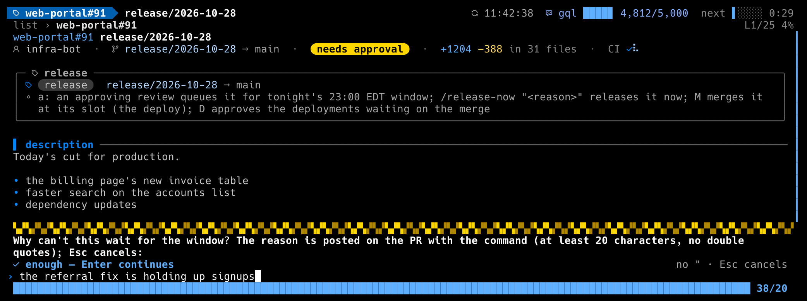

# The `release_pr` workflow

For application repositories that release to production by one path: an
open pull request into the production branch, either `release/<date>` (the
cut on the staging branch) or `hotfix/<slug>`. A human's approving review
is the gate; the merge is the deploy; environments may wait for an
approval before deploying. dillodash is that human's console across every
such repository.

```toml
[workflows.release_pr]
enabled = true
repos = "auto"                  # every repo in `org` a ruleset named `ruleset` applies to
org = "acme"
ruleset = "release"
production_branch = "main"
staging_branch = "stage"
```

Or list the repos explicitly: `repos = ["acme/web-portal", "acme/etl-jobs"]`.
Discovery reads the org's repo list and each non-archived repo's rulesets
once a day (cached under `~/.cache/dillodash/`); a repo appears by itself
the day after it is enrolled, or at once after the cache file is deleted.

## What you see

- **The `releases` section** sits below the pull requests. One row per
  open PR into production, per repo, as `repo#N`: a chip for its review
  state (`needs approval` gold, `approved by <who>`, `approved by me`,
  `changes requested`, `DRAFT`), a kind chip (`release`, or gold
  `hotfix`), CI (read through the same Actions fallback as the review list
  when the token cannot see the check rollup), author, age, title. `A`
  never hides a release: an approved one is in flight until it merges.
- **The `stage:` line** under each repo counts what the staging branch
  carries ahead of production by tag: `stage: 3 units ahead of main · 1 go
  · 1 hold · 1 untagged`. A unit is a first-parent commit of staging that
  is not on production; its PR number is read from the commit subject
  (`Merge pull request #N` or a squash's `(#N)`), and the tags
  `go_tag_prefix<N>` / `hold_tag_prefix<N>` decide the count. Untagged
  counts as hold: a unit nobody tagged does not release. `enter` does
  nothing on this line; `o` and `y` give its compare page.
- **A PR into production that is not a release** (its branch has neither
  prefix) is listed last in its repo, dimmed, with the chip `not a
  release`. It is not counted, and `a`, `M` and `D` refuse it. Set
  `list_other_prs = false` to hide them.
- **A queued release** shows under its night in the window section, not
  among the releases; its manifest item id is `rel:<repo>#<N>`. With
  `approval_queues_for_window = true` the approving review itself queues
  it (an open, non-draft `release/*` PR with an APPROVED review no older
  than three nights, a review with no recorded time counting as fresh; a
  hotfix never queues, and its `a` menu does not offer it), which is what
  the conductor's freeze picks up: it labels nothing before then. A
  release carrying the conductor's queued label is queued either way.
  Once the release is on its way (released NOW, or its slot came) it is
  back among the releases with its rail; one that ended without merging
  (a failure, a refusal) and still holds its approval goes back under its
  night, as the conductor would take it again.
- **A release in flight** (released NOW, or on tonight's manifest) shows
  its **rail** in the kind chip: a meter that fills as the release moves
  through the manifest repo's run, with the phase and its clock
  (`▰▰▰▰▱▱▱ deploying 3/9 · 2m`, `scheduled 23:00`, `released`, `release
  FAILED`). See [Live progress](#live-progress).
- **A merged release** stays listed for `merged_keep_secs` (12 hours) and,
  when nothing is following it, shows its deploy in the second chip: `approve: prod` (an environment you
  review waits), `waits: prod` (someone else's), `deploying`, `deployed`,
  `deploy failed`, `deploy cancelled`, `stuck? 1h05m` (a run queued or
  running longer than `deploy_stuck_secs`, 45 minutes by default), or `no
  Actions runs`. The card lists every run.
- **The summary row** counts `N releases need approval`, `N deploys wait
  on you (D)` and `N deploys stuck or failed`.

## `a` on a release





Open it with `enter` first. `a` refuses drafts, your own PRs, merged ones
and a PR that is not a release, then offers:

- **queue it for the window (approve review)**, when
  `approval_queues_for_window = true` and the window workflow is enabled:
  posts the approving review and nothing else; the conductor queues it.
- **release NOW** (`release_now_command`, default `/release-now`): asks for
  a reason of at least `release_now_min_reason` characters with no double
  quotes, shows the exact comment, then posts the review **first** and
  `/release-now "<reason>"` second. If the comment fails after the review
  landed, the status line says the release is approved but the command
  was not posted. With the window workflow on and `release_now_dispatch`
  (default true), it then fires a `repository_dispatch` on the window's
  `manifest_repo`, event `release_now_dispatch_event` (default
  `release-now`), payload `{repo, pr, comment_id}`: the comment lives in
  the release repo, whose events never reach the manifest repo's
  workflows, so this is how the conductor there learns to merge now. The
  payload only points at the comment; the receiver re-reads it by id. If
  the dispatch fails after the comment landed, the status line says the
  manifest repo was not told and points at `M`.
- A **hotfix** lists NOW first (enter picks it): a hotfix into production
  is an emergency by definition.
- A release **you already approved for this head** is queued already
  (where approvals queue), so `a` offers only **release NOW**: the same
  reason prompt and exact comment, then `/release-now "<reason>"` and the
  dispatch, with **no second review** (yours stands). This is the path for
  an approved release the window bumped or rolled. Once the release is on
  its way, `a` says so and posts nothing. Before 1.5.3 the core refused `a`
  on any PR you had approved, so an approved release could only be
  released now by posting the comment and firing the dispatch by hand.

Without the window workflow, an approving review is just an approval, and
`M` merges whenever GitHub allows.

## `M` and `D`

- `M` on an approved release merges it with `merge_method` (a merge commit
  by default), naming the head so a branch that moved after the approval
  is refused by GitHub. It refuses an unapproved, draft, blocked or already
  merged PR. With the window workflow on, inside `release_from`–`end` it
  asks once ("This DEPLOYS production"); outside the window it first asks
  you to call it an emergency (the `/release-now` reason belongs on the PR).
- `D` on a merged release (its row, or its detail) approves the environment
  deployments waiting on its merge commit, and nothing else: only runs
  whose head is that merge, only environments you are a reviewer of. With
  nothing to approve it says what the deploy is doing instead. The
  approval carries `deploy_approval_comment`.
- While a deploy waits or runs dillodash refreshes every
  `deploy_refresh_secs` and says once per environment when one starts
  waiting for you (`web-portal#143: prod now waits for your approval —
  press D on its row`). Approve `stg`, wait for the message, press `D`
  again for `prod`.

## Live progress


From the moment a release is sent on its way, dillodash follows it to its
outcome and shows where it stands, in near real time, without waiting for
the next refresh.

**What it watches.** The conductor's release job runs in the window's
`manifest_repo` as one run of `apply_workflow` (default `apply.yml`), fired
by a `repository_dispatch`; its title names the release
(`apply_run_match`, default `rel:{repo}#{number}`). The run's steps say the
phase: *setup*, *validating*, *merging*, *approving envs*, *deploying*,
*verifying* (the alarms are read after a five-minute settle), *finishing*. On the
release PR the job leaves an outcome comment (`## Released`, `## Release
FAILED: …`, `## Release UNVERIFIABLE`, `## Release NOT RUN`) and the
conductor's labels (`applied_label`, `failed_label`); on a window night the
manifest item's status says *scheduled*, *waiting for slot* (terraform
items first, or `/release`), *dispatched*. The app repo's own deploy runs
on the merge give the `n/m` while deploying. The newest signal wins, so a
`/release-now` posted again after a failed run reopens the story with the
new run.

**What you see.**

- **The row's rail**: one segment per run phase, filling blue as the
  release moves (deploying by runs done, verifying by the settle), a gold
  head that breathes while the phase runs, a sweep of light when it
  changes, stripes when it failed, a full rail once released. Next to it
  the phase and its clock, and a spinner (a rolling ball while a dispatch
  waits for its run). A scheduled release shows its slot and no spinner.
- **The detail's mission control**, in the release card: the state chip,
  the run and attempt (or the night and slot), a `T+` clock since the
  command (`T-` to the slot), the rail across the card with Amos walking
  it (the splash's Amos, small, in his own colors), one row per phase with its glyph and clock and a technical tail
  (the merge sha, `n/m runs`, the settle countdown, the approver), the
  outcome and the merge once it ends, the run's URL, and the last poll
  error if there was one. It redraws every frame while live.
- **One message when it ends**: `web-portal#90 released — verified on
  9f8e7d6 after 6m02s`, with the launch; `release FAILED at verifying —
  <detail>; run: <url>`; `release refused — <reason>`; a notice for
  *rolled*, *not run*, *cancelled* and *lost track*.

**How often.** Every `progress_poll_secs` (30 s) while something is in
flight: one listing of the apply runs when a release has no run yet, the
jobs of each run in progress, the comments of each release waiting for its
outcome, and nothing at all when nothing is in flight (a scheduled release
is polled from ten minutes before its slot). The whole-dashboard refresh is
untouched. A release with no outcome after `progress_timeout_secs` (90
minutes) is marked *lost track* and left alone. With `progress_poll_secs =
0` nothing is followed and the chips read as before.

**Without the manifest repo.** A token that cannot read the manifest
repo's Actions turns that half off for the session, with one notice; the
PR's labels, comments and deploy runs still carry the release to its
outcome. Set `apply_workflow = ""` to skip the runs on purpose.

**ASCII and motion off.** The rail draws with `#` and `-`, the stripes
with `/\`, Amos in line art; with `motion = "off"` nothing breathes or
sweeps and the card still redraws on every poll.

## Permissions

On every release repo the token needs Pull requests read and write (the
review), Issues read and write (the `/release-now` comment), Contents read,
Actions read, Metadata read (discovery), and for `M` and `D` Contents and
Deployments read and write. The release-now dispatch needs Contents read
and write on the window's `manifest_repo` (a `repository_dispatch` is a
contents write there); following the release there needs Actions read on
it (the run's jobs and steps). A repo the token cannot see shrinks the
section and puts the reason on the warn line; a repo whose read fails keeps
its last good rows with a warning.
