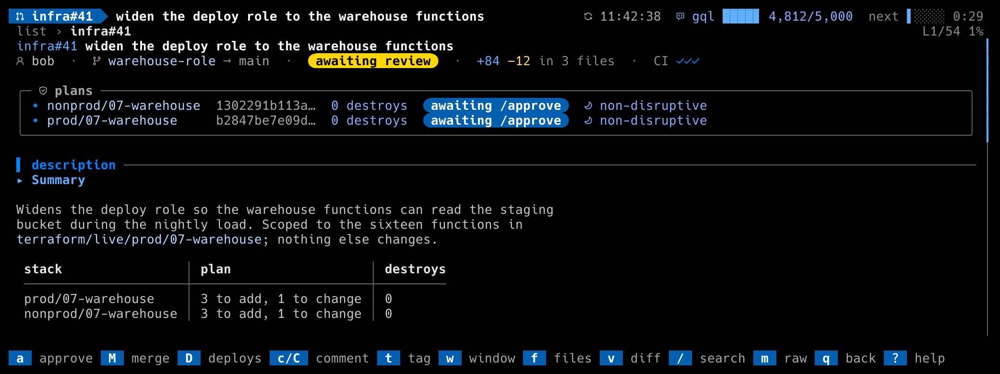
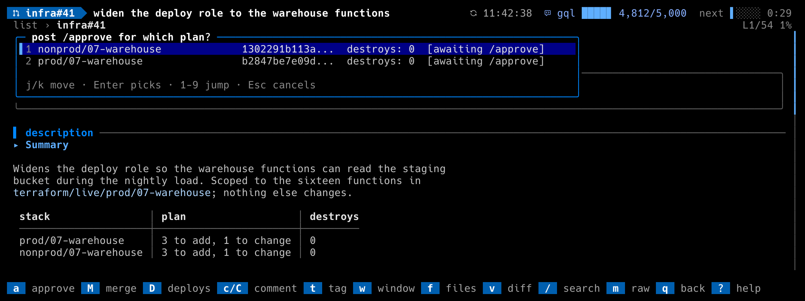

# The `terraform_approve` workflow

For repositories where applying infrastructure is gated on a comment: CI
plans every stack a pull request touches, posts a **plan digest** with a
plan id, and an apply pipeline runs only when an approver posts
`/approve <plan-id>`. dillodash's `a` key automates the approver's side,
and the detail view shows every plan's state.

Turn it on with:

```toml
[workflows.terraform_approve]
enabled = true
```

Every name below has a key in `config.example.toml`: the bot login, the
plan workflow's filename, the gate status context, the command and its
flags, the minimum reason length, the ceremony window.

## What `a` does





1. Scans the PR's comment thread for plan digests and keeps only the
   **live** ones. Several live stacks: a menu asks which; a plan-set is
   offered as one entry.
2. Shows the **exact comment** it will post, flags included, and asks. If
   the plan destroys anything you must type the destroy count: the same
   intent check the validator enforces.
3. If the digest's verdict says the plan is **disruptive** and the
   `maintenance_window` workflow is enabled, a plain `/approve` queues it
   for the next window instead of applying it. `a` says so and offers the
   deliberate alternative, `--outside-window="<reason>"`, with a reason of
   at least `outside_window_min_reason` characters and no double quotes.
   The prompt counts down and refuses enter until the reason is long
   enough. Advisory ("shadow") verdicts queue nothing and get no question.
4. Posts the `/approve` comment, then a GitHub approving review (a ruleset
   usually requires one for the eventual merge), best effort. When your
   review already stands on the PR (a plan you queued that the window
   bumped, now approved with `--outside-window`), `a` still offers the
   command and skips the review: since 1.5.3 the core's "already approved"
   refusal no longer stops it.
5. With no live plan it falls back to a plain review approval after a
   confirmation that says what it found. An **applied** plan is not live:
   an applied PR that is still open is waiting for the review that lets it
   merge, so `a` submits only that review, or, when you already reviewed
   it, says so and posts nothing.

Drafts are refused, and so is approving your own PR.

## The protocol the bot must speak

Comments are read from the bot login `digest_bot` (default
`github-actions`). Formats are exact; the regular expressions live in
`internal/workflow/terraformapprove`.

**A plan digest**, one comment per stack:

```
### plan `<env>/<stack>`

Plan-id: `<64 hex characters>`
Plan: 1 to add, 2 to change, 0 to destroy.
Window (policy; live): **non-disruptive**
https://github.com/<owner>/<repo>/actions/runs/<run id>
```

- The stack is `<env>/<stack>`, two path components.
- `Plan-id:` carries the sha256 the validator will check. `**Plan-id:**`
  (bold) is accepted too.
- The destroy count comes from the **last** `Plan: … N to destroy.` line
  in the comment. With none, `a` asks you to type it.
- The window verdict line is optional: `Window (<note>): **<verdict>**`
  where the verdict is `non-disruptive`, `disruptive · revertible` or
  `disruptive · NOT revertible`. A note containing `shadow` marks it
  advisory.
- A link to the Actions run identifies which run posted it; a digest from
  an older run than the newest one for the head is stale.

**Notices** that supersede a digest for the same stack:

```
### plan `<env>/<stack>` — no changes
### plan `<env>/<stack>` — skipped by CI
### plan `<env>/<stack>` — not CI-planned
```

**A plan-set**, when a PR has more than one change-bearing stack. The
validator then accepts only the set id, and a per-stack plan id is refused:

```
### plan-set
…
<!-- plan-set: {"set_id": "<64 hex>", "head_sha": "<40 hex>", "members": [{"stack": "env/stack", "plan_id": "<64 hex>", "destroys": 0}], "skipped": []} -->
```

`a` offers `plan-set (N stacks)`; the destroy count you confirm is the sum
across members; the set is disruptive if any member is; a set posted for
an older head is ignored; a single-member set keeps the bare plan id.

**A ceremony** (a scripted operation the bot runs instead of a terraform plan, with its own dry run):

```
### ceremony `ceremonies/<file>.sh`

Ceremony-id: `<64 hex>`
Head: `<40 hex>`
Window: **disruptive**: …
```

`a` offers `/approve <ceremony-id>` and never adds `--confirm-destroys`.
A `### ceremony … : dry-run FAILED` digest is shown but never offered. A
disruptive ceremony is not queued: inside `ceremony_window` a plain
`/approve` runs it; outside it `a` offers only cancel or run now with
`--outside-window`.

**The command** dillodash posts (`approve_command`, default `/approve`):

```
/approve <64 hex>
/approve <64 hex> --confirm-destroys=<N>
/approve <64 hex> --outside-window="<reason>"
```

The whole comment body is the command, it starts with the command and a
literal space, `--confirm-destroys=N` is present exactly when the plan
destroys N ≥ 1 resources, and the reason has at least
`outside_window_min_reason` characters and no `"`.

**Replies and outcomes** dillodash reads back, by their first line:

| Comment | Shown as |
|---|---|
| `**/approve refused:** …`, `**/approve not routed:** …`, `**/approve not dispatched:** …` | `/approve REFUSED — see the reply` on that plan; the refusal never gets the command highlight |
| `## Apply SUCCESS`, `## Apply SUCCESS (ceremony)`, `## Window apply VERIFIED` | applied (a ceremony's apply reports with the `(ceremony)` suffix) |
| `## Apply FAILURE`, `## Apply SKIPPED`, `## Apply CANCELLED`, `## Plan-set INCOMPLETE`, `## Ceremony FAILED`, `## Ceremony NOT RUN` | what happened, and that re-posting the same `/approve` resumes. A report that names <code>Approved: \`&lt;id&gt;\`</code> is pinned to that id |
| `## Apply REFUSED — saved plan is stale` | push to re-plan |
| `## Window apply FAILED verification … AUTO-REVERTED` / `… NOT reverted` | reverted, or a human is paged |
| `**Apply refused — …**`, `**Ceremony refused: …**`, `**Window item refused before apply (P0):**`, `**Dropped from the maintenance-window queue (night of …):**` | pinned to the newest `/approve` before them |
| `Auto-generated apply-log entry` (anywhere in a comment) | a bot bookkeeping comment; never read as a digest |

A newer `/approve` or success clears an older failure.

**The apply gate.** A commit status with context `gate_context` (default
`terraform/apply-gate`) in state success whose description starts with one
of `gate_done_prefixes` (`applied:`, `ceremony executed:`) means every plan
on the PR is applied. Such an open PR shows the gold chip
`applied, needs review`: the production branch is missing live config until
it merges, and `a` submits the review it is waiting for.

## When a digest is live

A digest is **not live** (shown dimmed with the reason, never offered) when
a newer digest exists for the same stack, when a later notice covers the
stack, when it predates the PR's current head commit, when its run is older
than the newest digest-bearing run on the PR, or when its run is not one of
the plan workflow's runs for the current head. The detail view fetches the
head's runs with one Actions call (`plan_workflow` names the workflow file);
when that returns nothing the check is skipped and the validator stays the
backstop. A stale `/approve` someone already posted is flagged loudly.

Hand-posted digests (`## Plan digest (hand-run …)` with the same `Plan-id:`
and summary lines but no `### plan` header) are attributed to their stack
through the skip notice they answer or a `terraform/live/<env>/<stack>`
path they mention, shown as hand-run, and never offered.
