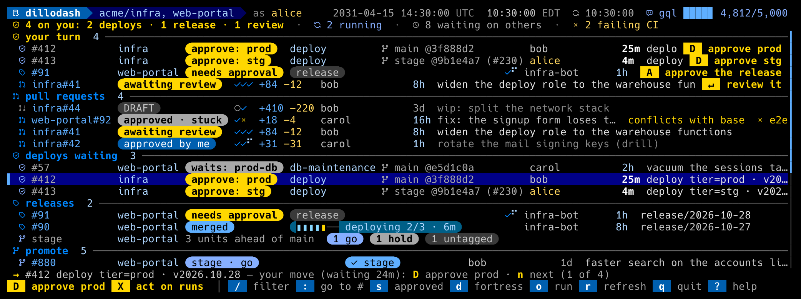
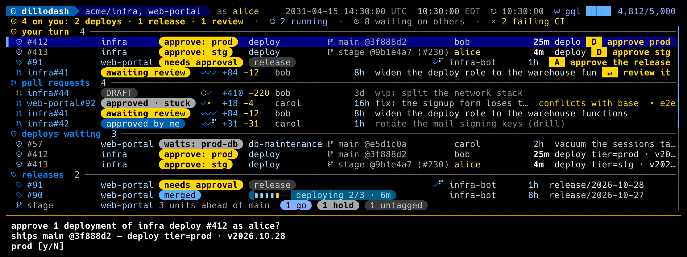

# The `waiting_runs` workflow

For repositories where Actions runs wait on a protected environment's
approval without a pull request behind them: a production deploy someone
dispatched by hand, an ops workflow run from `main`. The core's `D` finds
waiting runs only through a merged PR's merge commit, so these never showed
on the dashboard and the approver had to go to the Actions page. With this
workflow on, every run waiting on an environment gets a row, and `D`
approves it.

```toml
[workflows.waiting_runs]
enabled = true
# repos = "auto" (the default): every repo of the organization with an
# environment that needs a reviewer; or a list, read exactly:
# repos = ["acme/infra", "acme/etl-jobs"]
```

## Which repos

With `repos = "auto"`, the default, dillodash reads the organizations'
repos and keeps every one with an environment that has required
reviewers. A repo that gains such an environment is read without anybody
editing a config. A hand-written list that missed one hid its waiting
deploys entirely, so this is the default. The organizations are `orgs`,
else `[reviews] requested_orgs`, else the review repos' owners.
Environments change rarely, so the discovery is kept for
`discover_ttl_secs` in memory and in `cache`, and a new dashboard starts
from the cache. Its reads are conditional, so a rediscovery that finds
nothing new costs no rate limit. Only the repos found are polled.

A list reads exactly those repos. `gh dillodash config check` then names
any repo with a gated environment the list leaves out.

No bot protocol is involved: the rows come from GitHub's own Actions and
deployment APIs.

## Configuration

| Key | Default | Meaning |
|---|---|---|
| `enabled` | `false` | Turn the workflow on. |
| `repos` | `"auto"` | `"auto"`: every repo of `orgs` with an environment that needs a reviewer (see [Which repos](#which-repos)). A list of `"owner/name"`: exactly those repos, which need not be review repos. |
| `orgs` | `requested_orgs`, else the review repos' owners | With `"auto"`: the organizations to look in. |
| `discover_ttl_secs` | `21600` | With `"auto"`: how long a discovery is kept. |
| `cache` | `~/.cache/dillodash/waiting-repos-{org}.json` | With `"auto"`: the discovery cache. `{org}` is the organizations joined by `+`. |
| `approval_comment` | `"dillodash: approved {workflow} run {run} in {repo}"` | The comment GitHub records with each approval. `{repo}` is `owner/name`, `{workflow}` the workflow's name, `{run}` the run id; any other placeholder is a config error. |

## What you see



- **The `deploys waiting` section** sits between the pull requests and
  the releases, one row per waiting run, the one waiting longest first:
  the run number (`#412`, as the Actions page numbers it), the repo (when
  more than one repo is configured or reviewed), a chip per environment,
  the workflow's name, what triggered it (the branch, the short SHA, and
  the PR when the run came from one: `stage @9b1e4a7 (#230)`), who
  started it (the run's `actor`: the dispatcher of a `workflow_dispatch`,
  kept across re-runs), its age, and its title.
- **The chips.** `approve: prod` (gold, the title gold too) is an
  environment that is yours to approve now. `waits: prod · automatic` is
  one a `[bots]` login reviews, still within `deploy_auto_grace_secs`:
  automation approves it, and it becomes yours only after the grace.
  `waits: prod` waits on someone else. `waiting` means the environments
  couldn't be read (the warn line says why).
- **Your turn.** A run that waits on you is also pinned in the `your turn`
  section at the top of the list, with `D` and what it approves at the
  row's end. The hint line says how long it has waited, and the summary row
  counts it among the deploys on you. Its row in this section says who it
  waits on when it is not yours.
- **The poll.** The runs are read every `poll_secs` while one waits on you,
  or for 15 minutes after a run starts waiting or you act. Otherwise they
  are read every two minutes, and slower still while nobody is watching
  (`[display] idle_after_secs`).
- `/` matches the repo, the workflow, the title, the branch, who started
  it, the environments, the run number and the run id. `o` opens the run
  on GitHub, `y` copies its URL; Enter shows the URL (a run has no detail
  view).

The title is the run's `display_title`: the workflow's `run-name:`, else
the commit headline. The Actions runs API does not return a dispatch's
inputs, so a workflow whose inputs matter to the approver (which service,
which version, which environment) should put them in its `run-name:`:

```yaml
run-name: deploy ${{ inputs.service }} ${{ inputs.version }} to ${{ inputs.environment }}
```

## Runs that belong to a listed PR

A run on the commit of a change the `promote` workflow lists shows on that
change's row: `D` there approves it, and the row reads its environments
from this workflow.

A run the merge of a listed PR pushed is left out: its event is `push`
and its head commit is the merge commit of a merged PR the dashboard lists
in the same repo, a merged review PR's or a merged release's in the
`release_pr` section. Those show under their PR, and `D` on that PR
approves them through its merge commit, so a release's deploy is never
listed twice. The review PRs' runs are dropped at refresh (their
environments are not even read); the releases are matched when the list is
drawn, so a release that has left its section (after `merged_keep_secs`)
hands its still-waiting runs back to this one.

Every other waiting run is listed. A `workflow_dispatch`,
`repository_dispatch` or `schedule` run from the production branch carries
the branch tip as its head, which is usually the last merged PR's merge
commit; that PR did not start it, so it is never left out on those
grounds. A run waiting on an open PR's head is listed too: `D` on an open
PR does not approve it (it approves merged PRs only), so this row is where
it can be.

## `D`



`D` on a run row reads the run's environments again (someone may have
approved one since the refresh), then:

- when none is yours, says which environments wait and who can approve
  them, as GitHub names the reviewers: `infra deploy run 4242 waits on
  prod, but alice is not a reviewer (prod: bob, team deployers)`;
- when you dispatched the run yourself and the environment has
  "prevent self-review" on, says so instead (`… but alice dispatched it
  and the environment forbids self-review (prod: alice, bob)`): another
  reviewer approves it, or the run is re-dispatched by another account;
- otherwise asks `approve 1 deployment of infra deploy run 4242 as
  alice?` with one line per environment of yours (and the ones that are
  not), approves each with `approval_comment`, says what it approved, and
  refreshes.

The approval goes through your own `gh` token, the same as every other
action: GitHub checks that you are a reviewer of the environment.

## `X`

`X` on a run row offers what the Actions page would: **reject** the
environments it waits on that you review (a reason prompt, then a confirm;
the run fails there and deploys nothing) or **cancel** it. `x` reads a
job's log in `$PAGER`. `D` keeps approving and nothing else.

## Refresh, poll and failures

Every refresh reads one page (50) of each repo's waiting runs
(`GET /repos/{owner}/{repo}/actions/runs?status=waiting`) and the pending
deployments of each run.

An environment approval is usually given within minutes, often well
inside one `refresh_secs`, so between refreshes the same read runs every
`poll_secs` (default 30, floor 10; `0` leaves it to the refresh). Each
poll costs one REST call per repo plus one per waiting run. When a run
starts waiting on an environment you can approve (GitHub's
`current_user_can_approve`, which counts a team you belong to as well as
you by name), the status line says so once:
`<repo> <workflow> run <id> waits on you (<env>) — D approves it`. A repo whose runs can't be read is a warning
naming the permission when GitHub answered 403, and the other repos still
list; a rate limit pauses the workflow with the rest of the dashboard and
keeps the last rows.

## Permissions

On every repo in `repos` the token needs Actions read (the runs and their
pending deployments) and, for `D` and `X`'s reject, Deployments read and
write; `X`'s cancel needs Actions read and write. See
[auth.md](../auth.md).
